# Task01：环境准备与课前导读

导出日期：2026-11-16（北京时间）

## A Shell

学习日期：2026-11-16

实现截图

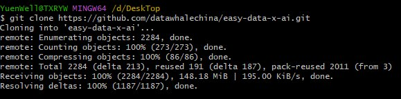

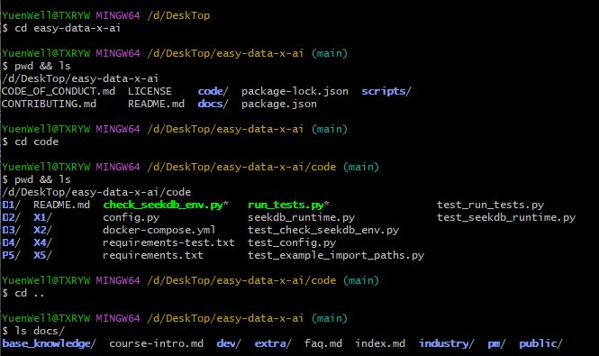

## B Python

学习日期：2026-11-16

实现截图

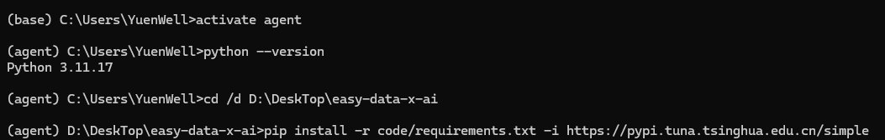

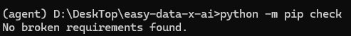

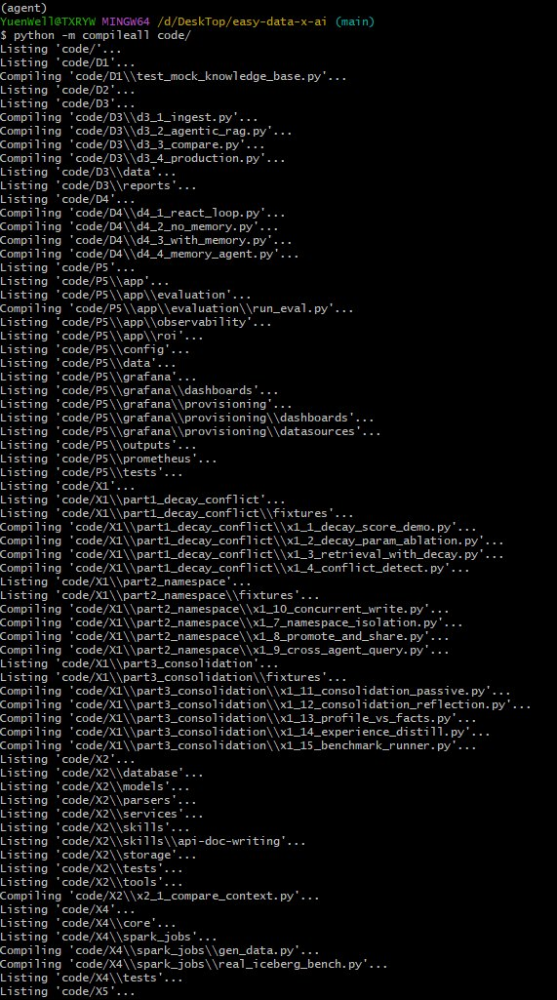

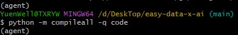

## C Requirements

学习日期：2026-11-16

实现截图

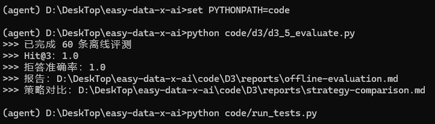

## D model API

学习日期：2026-11-16

实现截图

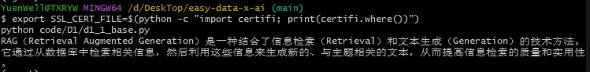

## E Git

学习日期：2026-11-16

实现截图

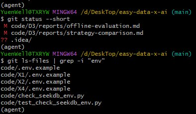

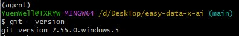

## F Vector Database seekdb

学习日期：2026-11-16

实现截图

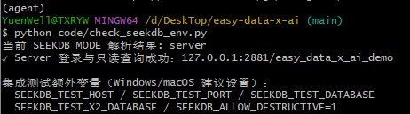

## F0

学习日期：2026-11-16

没有使用过openclaw，但是用过codex和deepseek harness，最近还打算尝试workbuddy，这里在我看来应该都是Agent。
三个错误的使用知识其实也没太遇到过，可能是目前这些harness和模型做得越来越好了。
就使用发现，确实是让一个Agent只专注于一件工作效果是最好的。也就是限制越多，效果越好（不得不感慨），所以才叫harness（控制）嘛。
Agent的培养也是我认为必要的，一开始就让它工作，没有给足够规范和示例，基本上出不来理想的效果，这些都是要提前描述的，衔接上一个问题，在培养足够的时间和内容后，可以做一个SKILL.md（我就是让它自己总结的），之后在其他类似情况下，可以做对应修改和更新
模型选择问题，emmm，主要用的多的是GPTsol-6.1和deepseek-v4.1-flash。除了模型感觉推理强度也是要考虑进去的，具体就是看工作复杂度吧。
骨架这部分，没见过的是USER.md，这些估计是harness后台会有设置，或者我们人为添加的，我将其作为工具使用的时候基本没注意过。我之前也调用过api，自己仿照github上面的一个开源库，仿写里面的代码，学习使用（这个库我会放在链接表示引用，对方教的是Anthropic格式的调用，我边向ai请教，边改成openai格式调用）。TOOLS.md和我想象的不太一样，我以为是我本地给它写的工具，这里实际是环境备忘。memory和MEMORY长短期记忆之前将deepseek尝试接入QQ时做过，也就是定期整理记忆。
打算之后继续学习，把agent用于专业工作流中吧

## F1

学习日期：2026-11-16

幻觉，目前其实使用得当的话，我很少见到，这也是得益于技术的不断迭代。
目前查网络资料学习到的分为2类：
内在型，与输入或者上下文矛盾，就是自己否定自己
外在型：无法找到依据的输出，经典的就是不知道的就编
每类有分别有两种：
忠实性：输出偏离指令或者约束，比如让他设计天线，给出的是mm的参数，结果输出变成了cm的参数
事实性：生成无法验证的陈述，事实上错误的，感觉这个一般和外在型一起出现
忠实性的幻觉可以靠提示词这些抑制，事实性则是靠RAG这些来应对。
回到话题，如同课程所说，幻觉问题的根因是缺少可验证的事实数据，不是模型不够聪明。
知识截至的问题，现在很多模型都支持联网搜索，这大大扩展了其知识内容，可以获取最新的知识辅助推理回答（但是直接问好像不会尝试找新的知识，比如我之前问过ds一些gpt-sol模型的问题，它回复的都是针对sol5.6版本的，而现在写这篇记录的时候6.2都快出来了）。对于新的消息，最好是前面主动提示一下。
个性化盲区，emmm，这个不怎么考虑过，感觉就是养多了，自己就记住了，可能还是模型或者harness现在做得比较好的原因。就比如codex里面就有个性化的设置。
Token，这个跟不同模型厂商的 Tokenizer是不一样的，高频词和低频词的token划分也是不同的，api计费根据这个。
上下文，这个更接近与我们理解的记忆吧，毕竟每次对话实际都是把之前上下文发给模型，但是也是有上限的，不过现在都有压缩compact，重要的记录就放在memory.md里就行了。
目前也是打算减少幻觉使用，同时少花token

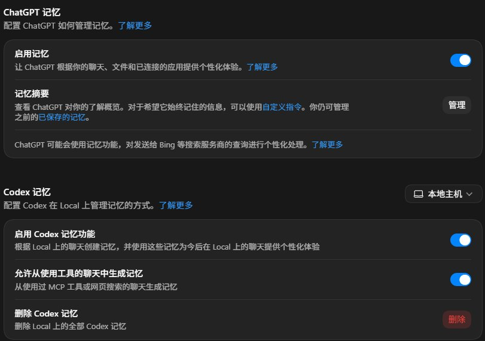

## F2

学习日期：2026-11-16

在报名这次学习前，自己也自学过datawhale的Hello-Agents，虽然学的不是很精通吧（自己不是很自信）。LLM本质还是大语言模型，或者说NLP，就是能理解自然语言，现在很多vibe coding，就是将人话，转译成机器语言（代码）。但是想要在电脑上做项目，只会理解和推理是不够的，LLM是大脑，所以Tools和MCP这些实际是Agent的手脚，让他真正能干活。
ReAct，这个也是之前自学过了，我身边典型的例子就是deepseek的深度思考吧。先思考，再行动，能使得其能够更加准确或者说有逻辑支持地执行任务，还有Plan-and-Solve，这个感觉和todo这个harness现在一般自带的工具比较类似，就是把工作拆分，严格按照计划进行，和ReAct的功能类似吧。Workflow就没太了解过，趁机也学一下吧。
核心还是Data × LLM，在我看来，就是基础的支持和顶端的推理决策，其他功能都是路由或者调用去执行。
RAG/MCP/Skill/Memory的概念都差不多明白
RAG是增强式检索生成，从数据库中提取知识，交叉验证，但是很依赖数据库的质量
MCP是模型上下文协议，规范定义了工具的调用，因为大模型发展迅速，方向多样，要求harness官方全部适配好是不合适和不现实的，我们本地写的工具，虽然也能用，但是不方便，自己写的也不好兼容，MCP就是规范好格式，本地配置好后，直接接入云端的工具库，方便使用。
Skill技能，其实就是总结好了的提示词吧，我个人认为，skill给出了规范，流程，约束甚至包括例子等信息。我们都知道模型每次的回答是不一样的，质量也是，但是skill就能最大程度的保证基本质量和效果，其次就是可以很方便的迁移到其他应用中。
Memory就是很直观的意思，记忆，包括之前对话和执行的内容，记住对话偏好，失败教训，做过的记录。
核心是数据确实是之前没考虑太多的，这次结合起来，发现确实如此，算是找到了新的角度。
之后的主要目标是学习RAG这个相对没实际试过的内容，用到我的Agent设计中。

## 公式解读

学习日期：2026-11-16

回到公式
AI 产品的能力上限= 数据质量x 模型能力
AI Agent的能力上限= 模型能力x数据质量+流程编排
模型能力可以提升数据运用执行的效果和质量，数据质量可以保证模型的准确性和即时性。
流程编排则是Agent里面的一系列约束规范，稳定下限，提高效率。

## 三个问题

学习日期：2026-11-16

最后是三个问题
1.最近一次「AI答得不好」是什么时候?它缺的是哪种数据?
我个人认为最近的一次，就是之前笔记里面描述的。如图所示，他的回复都是gpt-5.6，虽然现在这个模型也还是有吧，但是结果确实不好。显然缺乏的数据是我没有说明模型是gpt-6.1，当然，模型训练的时候这些知识可能还不存在。这方面我没注意过。
2.你手边的AI工具(或你想做的东西)，缺的是哪项能力?根源在哪?
我目前已经搭好了一个harness的框架，能够实现本地工具的调用，记忆，上下文压缩等Agent-loop这些功能。目前缺乏的能力主要是MCP和RAG，因为我想让它执行程序脚本做设计，然后根据结果给出我优化建议，但是目前的反馈都缺乏专业性和针对性，显然是缺乏专业知识和足够的数据支持。所以想要自己再搭一个RAG，MCP则主要是想要扩展可用性，以后可能可以做一个完全自己的harness，可以个性化定制修改。
3.AI应用效果不好时，你的第一个动作是什么?
我首先会查看我的提示词是不是不够具体或者有误导，排除我的问题，然后针对AI回答的问题进行查找，比如回答的过时，我会要求它查新的数据，回答错了，我会反问，提出质疑，和其他地方的数据比对，回答的不专业，我会先教一下怎么回答。

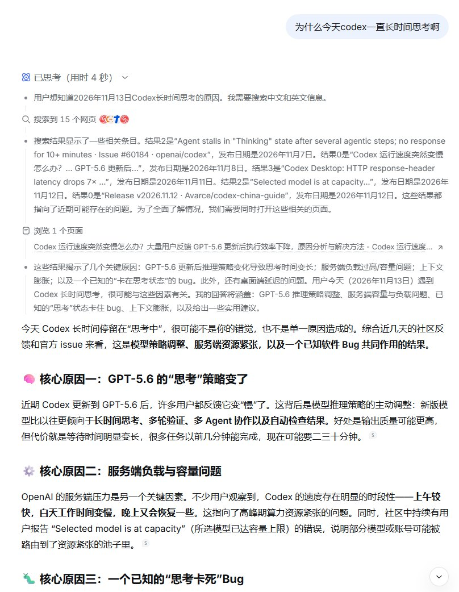

## 问题与解决

学习日期：2026-11-16

遇到的问题有
只装了requirements.txt的依赖，没有注意requirements-test.txt，导致测试报错
httpx和httpx2与openai>=3.0的冲突报错，问了ai手动修改了兼容问题
尝试真实调用deepseek，但是api没有识别，最后发现工程内默认用的是硅基流动的代码，选择注册账号解决了
尝试用conda来处理所有测试，发现和测试给代码的用win难搞，最后选择了GitBash解决

## 参考来源

| 资料名称 | 参考用途 | 仓库链接 |
| --- | --- | --- |
| Easy Data × AI | 本次课程的教程与示例 | [datawhalechina/easy-data-x-ai](https://github.com/datawhalechina/easy-data-x-ai) |
| Hello-Agents | Agent 相关延伸学习 | [datawhalechina/Hello-Agents](https://github.com/datawhalechina/Hello-Agents) |
| Learn Claude Code | Agent Harness 与代码实现参考 | [shareAI-lab/learn-claude-code](https://github.com/shareAI-lab/learn-claude-code) |

