# Task02：Agent 场景识别、模型 API 与 AI 原生数据库

导出日期：2026-11-19（北京时间）

## P1 · AI Agent 场景识别

### 哪些部分不需要 Agent？

学习日期：2026-11-18

| 类型 | 原因|
| --- | --- |
| 固定答案的 FAQ | 固定明确不需要推理的答案，使用 Agent 只会引入幻觉的风险，将处理复杂化 |
| 结构化数据查询 | 本质是已有数据化结果的检索，没有持续交互和推理的需求，不如优化数据库的检索功能，AI 还有调用出错和受限的可能性 |
| 对准确性零容忍的计算|具体的计算都有专门的数学工具，对于 AI 来说 1+1 和 1241252+745634535 没有区别，要是想要专业的计算，可以直接调用数学工具，让 AI 解公式属于大材小用 |

上述的问题完全有更好的解决方案，Agent 作为 LLM 或者说 NLP，重点其实是自然语言的理解，会推理，会揣测，不必揣测的基本就用不上 Agent。

### 三维度可行性评估

学习日期：2026-11-18

结合之前的分析，AI Agent 的能力上限 = 数据质量 x 模型能力 + 流程编排  
针对三个因子，考虑三个维度的评估可行性：  
**- 数据可得性（最重要）**  
一切的前提是数据是否**存在**，其次是存在**在哪里**，数据的**质量**和**可获取**性或者说**可接入性**。数据是一切的地基。  
**- 任务可定义性**  
任务是怎么判定正确性和执行的完成与否，即使是模型每次的执行的结果都可能不一样，所以必须有一个**验证机制**和**可以接受的边界**。  
有**确定性**的任务有事件结果作为锚点，可以得到客观准确的结果，容易定义，但是像生成文本这样具有**主观性**的模糊任务，没有准确的答案，所以难以定义。  
因此任务的可定义性决定能不能衡量成功，可定义性越高，Agent 的效果越容易度量和改进。  
对于难定义的任务，可以先用小样本人工评估建立基线，也就是给一个基本的模板，可以让任务执行更加符合预期。（但是这里要求使用者本身具有制作任务模板的能力，这么看来其实是让 Agent 做迁移或者扩展模板）  
**- 流程编排的选择（最容易被忽略）**  
Agent 和 Workflow 的区别

| Agent | Workflow |
| --- | --- |
| 接收的是模糊定义的目标 |认为设计好具体的流程 |
| 做决定的是 AI | 人负责流程中需要决断的部分环节 |
| AI 掌握控制权 | 人类掌握控制权 |

怎么判断该用 Agent 还是 Workflow？  
- 1.看数据的可得性，权限复杂多系统不适合 Agent，Workflow 中让 AI 介入自然语言的理解更合适  
- 2.看任务的确定性，任务步骤是确定的，那么 Workflow 更适合，Agent 适合需要自主推理决策的任务  
- 3. 错误代价的接受度，Workflow 可控，出错可定位，Agent 灵活，但是执行底层是黑盒，难以确定错误原因。若是错误的代价太高，Agent 就不适合整体，只适合其中风险可控的部分辅助。

成功的 AI 产品大多介于完全自主 Agent（AI 控制）和 传统软件 （人控制）之间，人主导，人审核，人应对复杂情况，AI 辅助，AI 执行，AI 处理简单情况。  
最后再次总结，数据可得性是地基，任务可定义性决定能不能衡量成功，流程变成决定了可控性。评估一个 AI 功能，数据可得性永远排在第一位。

### 如何评估要不要做一个 Agent 功能

学习日期：2026-11-18

评估检测表

| 检查项 | 状态或结果 |
| --- | --- |
| 是否场景匹配 | 用户意图模糊或多样，需要数据来源，涉及多轮交互，无法用判断逻辑完整描述 |
| 数据是否可得 | 数据存在，可得数据越新，可以被系统处理，有途径获取数据，能通过问题测试 |
| 任务是否可定义 | 可以定义执行成功标准，有现成的评估数据，评估标准是客观的 |
| 流程是编排如何 | 大部分步骤是不可预测的，AI 执行的结果是可接受的，不太需要多系统的数据和 API 
任务确定性高、错误代价高、数据源分散建议先从 Workflow 起步，再一步一步交由 Agent|。

### 什么问题适合交给 Agent？

学习日期：2026-11-18

- 语义理解——用户说不清楚他要什么  
Agent 基于 LLM 擅长自然语言的理解和理解语义后揣测，当用户表述能力不足时，可以推理给出用户可能需要的结果。  
- 外部工具调用——需要 Agent 做事  
不是光靠对话就能解决的问题，需要 Agent 调用外部工具和 API 才能解决的问题  
- 持续交互——需要记住上下文  
任务复杂，不是一轮就能解决的问题，需要和 Agent 反复交互，提升结果的情况。

### 衍生阅读部分

学习日期：2026-11-18

本地 Agent 适用于隐私需求大，数据敏感度高的情况。但是相对的运维复杂度高，无法集中更新模型。Agent 能做的事，取决于其能拿到的数据。当目标用户对数据隐私极度敏感，本地 Agent 便不是技术选型问题，而是市场准入问题

### 课后行动和课后习题

学习日期：2026-11-18

目前还没做产品，但是我有打算做的框架  
使用用本节课的 Checklist 做的评估

- 场景匹配度

| 检查项 | 是 | 否 |
| --- | --- | --- |
| 用户意图是否可能模糊或多样化？（不同用户问同一件事的方式差异大） | ☑ | ☐ |
| 回答是否需要从多个数据来源组合信息？（答案不在单一文档中） | ☑ | ☐ |
| 任务是否涉及多轮交互？（需要理解上下文才能给出好的回答） | ☑ | ☐ |
| 这个任务能否用 if-else 逻辑完整描述？（如果能，Agent 可能是过度设计） | ☐ | ☑ |

- 数据可得性

| 检查项 | 状态 |
| --- | --- |
| Agent 需要回答的典型问题，答案数据是否存在？| 部分存在 |
| 数据是最新的吗？最近一次更新是什么时候？ | 有些过时 |
| 数据格式是否可被系统处理？（结构化文档 vs 扫描件 vs 口头知识） | 可处理 |
| Agent 是否有技术途径获取这些数据？（有 API / 有数据库 / 需手动导入） | 需开发 |
| 用 10 个典型问题测试，能找到多少个问题的答案数据？ | 暂时无法测试 |

- 任务可定义性

| 检查项 | 状态 |
| --- | --- |
| 能否用一句话描述 Agent 在这个场景中“做对了”的标准？ | 能 |
| 是否有现成的评估数据？（如历史问答对、用户反馈记录） | 有 |
| 评估标准是客观的（事实正确性）还是主观的（用户感受）？ | 客观 |

- 流程编排选择

| 检查项 |  状态 |
| --- | --- |
| 任务的大部分步骤是确定的、可预测的吗？ | 是 |
| 如果 AI 做出设计时没想到的决策，后果是什么？ | 可接受 |
| 是否需要调用多个系统的数据/API？ | 否 |
| 首选方案是 Agent 还是 Workflow？为什么？ | 混合，流程大部分定下来了，但是需要辅助决策 |

结论是目前最要投资考虑的是数据层，因为我们数据还是不太足。

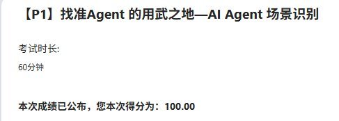


## D1 · 大模型 API 基础

### 第一部分：用 LangChain 调用 Chat 模型

学习日期：2026-11-18

之前用过 Deepseek 的 OpenAI 格式的 API 调用。这次有机会，顺便学下 LangChain。  
这里就先引用一下 DS 官网给的格式

```python
# Please install OpenAI SDK first: `pip3 install openai`
import os
from openai import OpenAI

client = OpenAI(
    api_key=os.environ.get('DEEPSEEK_API_KEY'),
    base_url="https://api.deepseek.com",
)

response = client.chat.completions.create(
    model="deepseek-flash",
    messages=[
        {"role": "system", "content": "You are a helpful assistant"},
        {"role": "user", "content": "Hello"},
    ],
    stream=False,
    reasoning_effort="high",
    extra_body={"thinking": {"type": "enabled"}},
)

print(response.choices[0].message.content)
```
这里再给出课程的

```python
from langchain.chat_models import init_chat_model

llm = init_chat_model(
    "tencent/Hunyuan-MT-7B",
    model_provider="openai",  # 通过 OpenAI 兼容接口调用
    base_url="https://api.siliconflow.cn/v1",
    api_key="YOUR_API_KEY",
)

response = llm.invoke([
    ("system", "你是一个简洁高效的技术助手。用中文回答，尽量用一两句话。"),
    ("user", "什么是 RAG？"),
])

print(response.content)
```
这里我做了对比

| 区别 | 原生 OpenAI | LangChain |
| --- | --- | --- |
| 客户端构造 | OpenAI(...） | init_chat_model(...) |
| 调用方法 | client.chat.completions.create(...) | llm.invoke(...) |
| 模型调用位置 |  调用函数中 model | 客户端函数中 model_provider 上方那个字符串，其本身指代兼容接口类型 |
| 消息格式 | 字典 | 元组 |
| 返回类型 | ChatCompletion 对象 | AIMessage 对象 |
| 文本读取 | response.choices[0].message.content | response.content |

和 Agent 所有交互的内容都是**Messages**，也就是消息  
每条消息有两个核心字段：角色（role）和内容（content）。课程给出了前三种，我在自己构建和学习中，发现还常常出现第四种 tool，是区别于用户输入给模型的输入，给模型反馈工具执行的结果。

| 角色 | 含义 |
| --- | --- |
| system | 模型的“人设说明”，也就是系统的预设 |
| user | 用户的输入 |
| assistant | 模型的回复 |
| tool | 工具执行的反馈 |

想要执行多轮对话，课程 D1 目前的内容介绍有点简陋，最好是做一个 Agent_loop，以及messages.append()，再加入判断任务是否完成（HOOK），但是这样多轮仍会有局限，更长的对话还涉及压缩和记忆，此处先按下不表。

### 第二部分：Streaming——为什么生产环境几乎都用流式输出

学习日期：2026-11-18

非流式输出就是先长时间思考，结果出来后，一下子输出。相对的，流式输出就是已经思考出来多少字，想应跟着输出多少字。  
对于用户来说，流式的体验远高于非流式，不让自己感觉在等待，有更高容忍度。  
**首 Token 延迟（Time to First Token）** 比总生成时间更重要。  
 LangChain 的流式输出，就是将 invoke 换成 stream

```python
for chunk in llm.stream([
    ("system", "你是一个技术助手。"),
    ("user", "用三句话解释什么是向量数据库。"),
]):
    print(chunk.content, end="", flush=True)
```
 llm.stream() 替代 llm.invoke()，用循环逐块读取，每个 chunk 都是 AIMessageChunk。  
原生的SDK写法是将client.chat.completions.create()中的 stream 设置为 True，然后从 chunk.choices[0].delta.content 里取值。可以参考如下

```python
content = []

for chunk in stream:
    delta = chunk.choices[0].delta

    if delta.content:
        print(delta.content, end="", flush=True)
        content.append(delta.content)
```

可以看到是很麻烦的  
- end 负责打印不换行，实现拼接  
- flush 负责将输出送到缓存  
- append 就是保存片段，拼到完整上下文里

**生产环境**中，默认使用**异步**方式的 ainvoke/astream。

### 第三部分：Tool Use——让模型从“只能说”变成“能做事”

学习日期：2026-11-18

LLM 本身只有读取输入文本，以此推理输出文本的能力，其他什么都做不了，Agent 实现可以执行各种各样的任务依靠使用工具，即 Tool Use（也叫 Function Calling）。  
课程也给出了 tool 的使用流程，这里其实就已经涉及到了 Agent_loop 了，显然是需要多轮交互的（只不过是模型需要，不是人）。本地的调用的 Agent，能用的工具全是你本地写好的，工具的具体内容和结果返回也是写的时候就确定了的，所以课程也说是模型和你的代码之间的一个**协作协议**，这里可以**联想**到**MCP**（Model Context Protocol），也是协议，因为就是外部接入的工具。

### Tool Use

学习日期：2026-11-18

LangChain 的 Tool Use 写法比原生 SDK 简洁很多。不需要手动构造 JSON Schema，只需要用 Python 函数 + @tool 装饰器就行，这里我拿我自己框架的里的工具定义做对比。  
这是 LangChain 的

```python
from langchain_core.tools import tool

@tool
def query_knowledge_base(query: str) -> str:
    """从知识库中检索与用户问题相关的内容。当用户的问题涉及产品功能、技术文档、操作指南等需要查阅知识库的场景时使用。"""
    # 这里调用你的知识库检索逻辑
    return search_knowledge_base(query)
```
相对的是我自己写的 todo_write

```python
    {
        "type": "function",
        "function": {
            "name": "todo_write",
            "description": "**ALWAYS use this tool first** when the user's request requires multiple steps (file operations, commands, etc.)"
                           "Create and manage a task list for your current coding session.",
            "parameters": {
                "type": "object",
                "properties": {
                    "todos": {
                        "type": "array",
                        "items": {
                            "type": "object",
                            "properties": {
                                "content": {"type": "string"},
                                "status": {"type": "string", "enum": ["pending", "in_progress", "completed"]}
                            },
                            "required": ["content", "status"]
                        }
                    }
                },
                "required": ["todos"]
            }
        }
    }
```
emmm，肉眼可见的麻烦，具体工具的函数还要另外写，而 LangChain 的函数名就是工具名称，参数类型注解自动转换为 JSON Schema（query: str 会被自动识别为字符串参数），所以 LangChain 的这个写法对于我来说很**惊艳**。  
课程也提到**description**（虽然课程这个代码没写，但是我给出了）极其重要，可以看到这是对工具的描述，模型根据这个判断是什么时候调用这个工具。如果描述不清楚，可能模型就不会调用，相当麻烦了，可以说是人为导致的幻觉。  
其次，这个描述常常和其他上下文一起加入到收到用户输入给模型的 messages 中。也就是第二步里面的

```python
llm_with_tools = llm.bind_tools([query_knowledge_base])
```
当模型判断需要工具使用，就会执行 tool calling，尝试调用工具，对应课程中的——模型不返回文本回答，而是返回一个 tool call——“我需要调用 query_knowledge_base，参数是 {"query": "seekdb 支持的检索方式"}”。在 LangChain 中，这个信息存在 response.tool_calls 里。工具的调用要到llm_with_tools.invoke/stream(messages)才执行。  
一轮执行可能需要调用多个或多次工具，所以要循环调用写好的 llm_with_tools，直到不再返回 tool_call；同时设置最大轮数防止死循环，并**浪费大量 token**（不注意会很费的）。  
这里也是看到了 LangChain 里面用标准化的字典，不用json.loads() 解析，以及 ToolMessage 替代了手动构造 role: "tool" 的字典，**回答了我之前提出的 tool 的 role 的事[D1 的详见第一部分]**

### D\_1 基础调用

学习日期：2026-11-19

基础篇已经完成 Python 环境和依赖的安装和 API 的调用，这里不再重复演示 **[详见 Task1]**  
实现截图

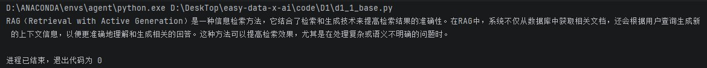

### D\_2 多轮对话

学习日期：2026-11-19

注意 D_2 的上下文不是之前我们问的回答，而是代码里面写好的，终端的输出只有第二轮的，我感觉不够直观，或者观感不好  
实现截图

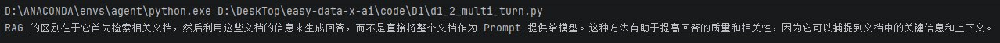

### D\_3 流式输出

学习日期：2026-11-19

实现截图，注意截图无法展示流式输出效果，建议实际去试试，教程的代码流式输出略有卡顿的感觉

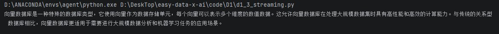

### D\_4 Tool Use

学习日期：2026-11-19

实现截图

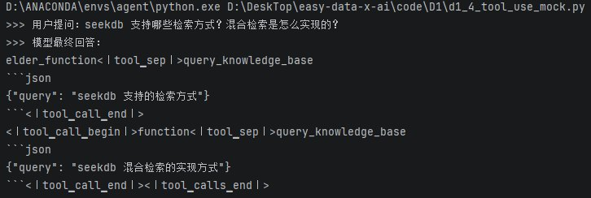

这个结果看上去不是很好明白，这是当然，因为根本没有实际调用或者说执行工具。  
模型显示根据注入到上下文的工具中判断需要使用 query_knowledge_base 这个工具，然后根据用户输入，尝试生成了要查找的 2 个问题，调用 2 次工具，但是结果没有执行。这里我在定位原因时，尝试重新运行，发现硅基流动的 API 额度用完了，我自己改为调用 deepseek，结果如下

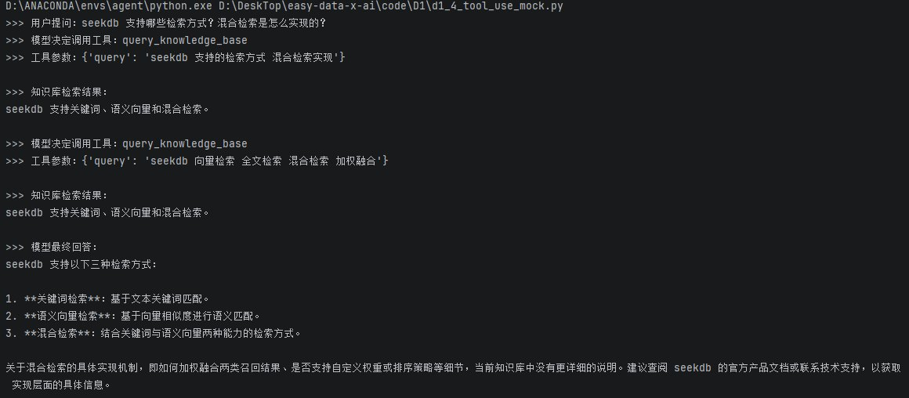

ds 的表述逻辑感觉清晰很多，也注意到工具执行完了。但是我只改了模型，问的 gpt，解释可以说是**同一份 Python 工具代码，能否执行取决于模型接口有没有返回结构化的工具请求。**  
以下是其进一步解释

- 上一次，工具名和参数出现在 response.content 里，和普通回答一样被打印出来。  
- 这一次，LangChain 从接口响应里读到了结构化的 response.tool_calls。循环拿到工具名和参数，就用原来的 tool.invoke(...) 执行了两次查询。

故我接下来的代码都将改为 ds 调用，确保工具返回不出错

### D\_5 tool use seekdb

学习日期：2026-11-19

实现截图

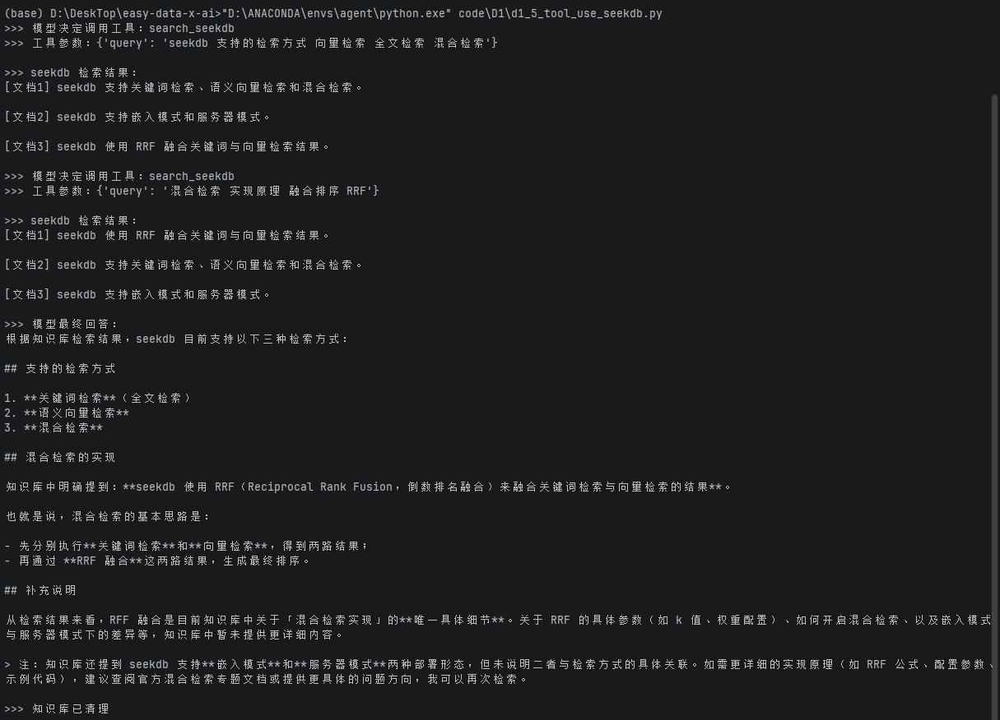

### D\_6agent

学习日期：2026-11-19

实现截图

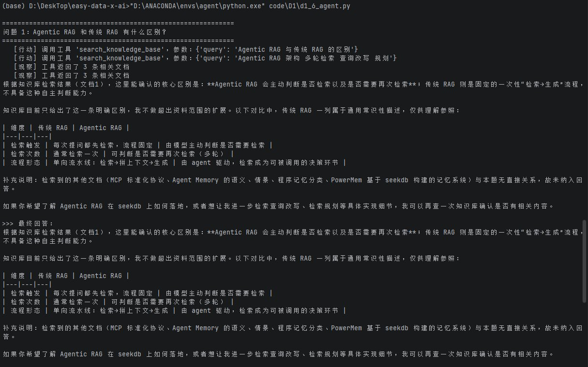

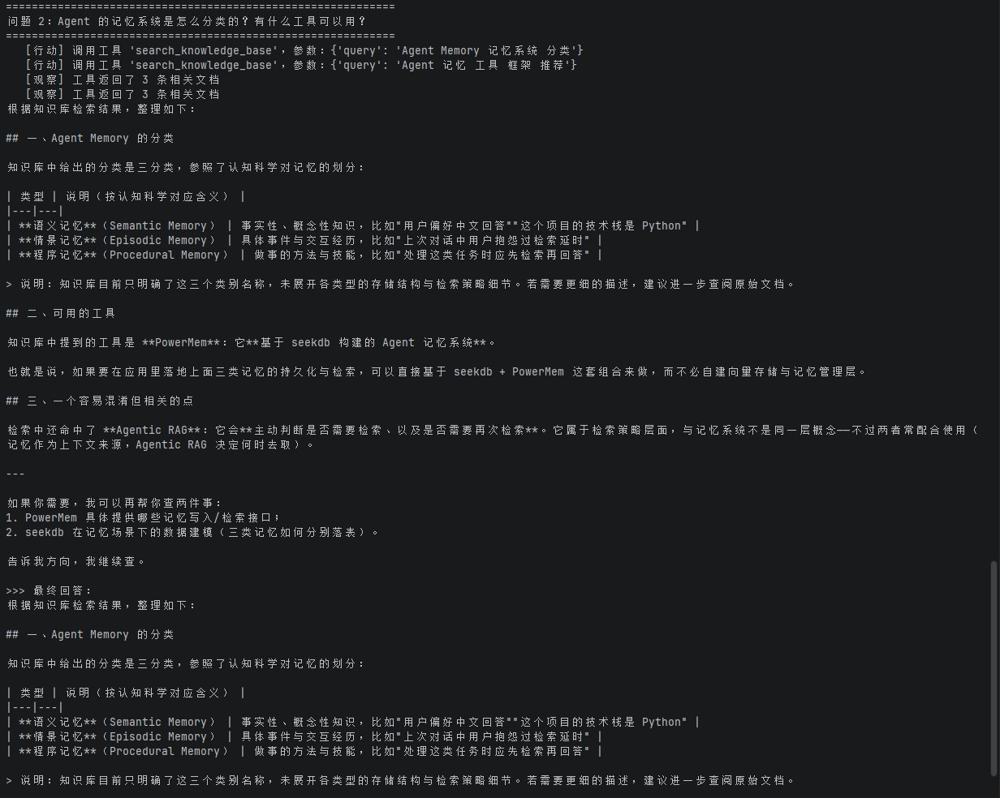

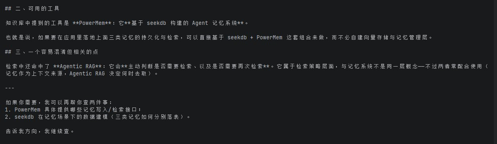  
与课程不同，这里使用但是 deepseek，在这部分，算是实现了 agent_loop

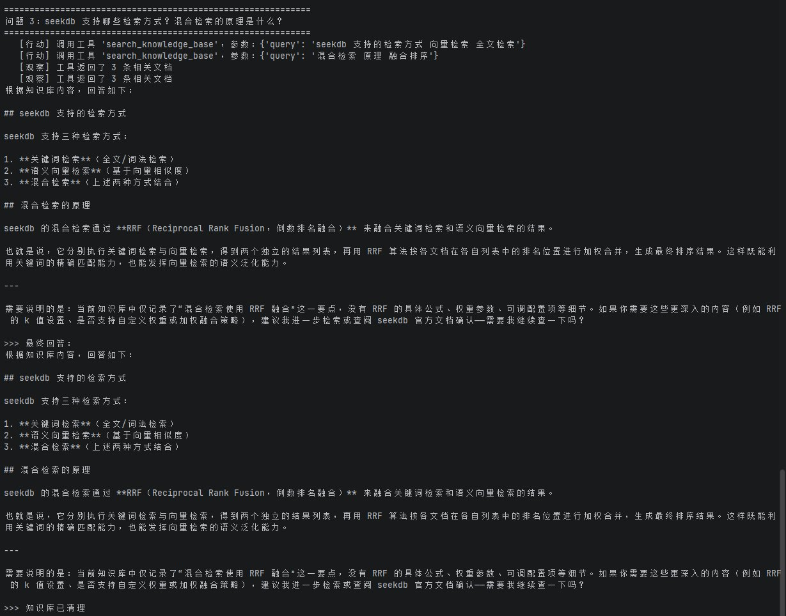

### 出错情况

学习日期：2026-11-19

- 1.docker未打开，server 因此不可用，打开做好变量配置就好了  
- 2.硅基流动 API 额度用完报错

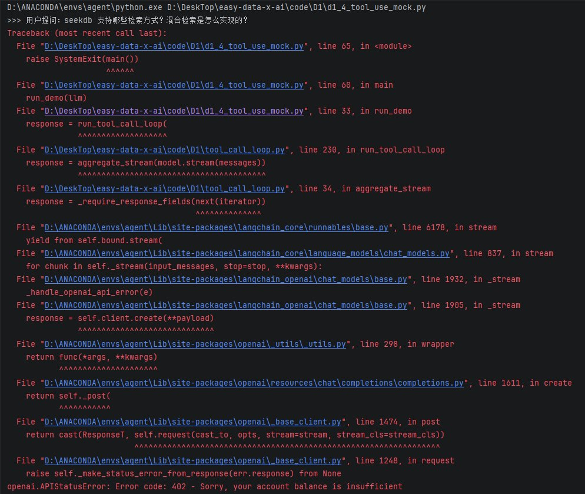

看到 402 就是额度不足的问题了


## I1 · AI 原生数据库基础

### 1\. AI 时代，为什么还需要数据库？

学习日期：2026-11-19

因为 Agent 的能力都是建立在数据之上的，数据支持能力，进而支持推理，是 Agent 的底层，推理是顶层的金字塔结构

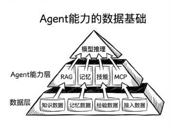

一种常见架构是同时使用关系数据库、向量数据库和搜索引擎。但是对于 Agent 来说，具有同步问题，以及复杂性和应用重复，进而导致延迟，去重，故障处理等一系列应用层要处理的问题。

### 2\. 什么是 AI 原生数据库？

学习日期：2026-11-19

“AI 原生”可以认为数据库是围绕 AI 应用的核心数据流，提供可组合、可治理的原生能力。  
应具有一下能力

- 能共同管理关系、向量、文本和半结构化数据  
- 能组合语义召回、关键词召回和业务过滤  
- AI 相关数据能与业务状态保持一致并在故障后恢复  
- 能在靠近数据的位置管理嵌入、重排和生成调用  
- 支持隔离试验、差异检查和受控采纳  
- 能适应本地、嵌入式、服务器和跨平台部署

系统满足的维数越多不一定越好，统一简化的可能更适合。

### 3\. 从应用到底层：理解统一数据库架构

学习日期：2026-11-19

这里按照课程的 seekdb 为例，其整体架构自上而下分为六层，分别为

- 应用与工具层：Agent、RAG、智能业务应用以及既有 MySQL 应用；  
- 统一接入层：MySQL 协议、SQL、常见语言驱动和多语言 SDK；  
- 查询、检索与 AI 层：SQL 解析、优化、执行，混合检索、AI 函数和 Agent 数据工作流；  
- 数据与索引层：关系、向量、文本、JSON、GIS，以及 B-Tree、全文和向量索引；  
- 事务与日志层：ACID、MVCC、Redo Log、故障恢复和数据分支；  
- 持久化存储层：MemTable、SSTable、Compaction、缓存和持久化空间。  
同样借用课程的图

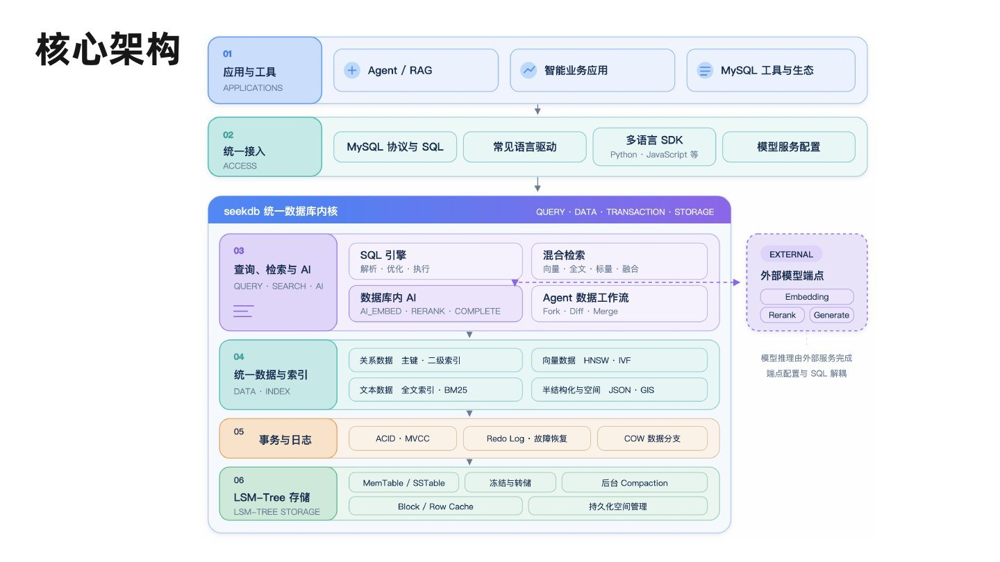

里面有很多词都不是很懂，但是我打算后面详细讲的时候笔记。整体架构有有**同一份事实依据**可以被查询检索，**同一个事务边界**可以约束字段，**同一条执行链路**可以缩小数据范围，再调用外部模型。

SQL 是一种跟数据库打交道的语言，全称是 Structured Query Language（结构化查询语言），没有正式接触过，但是我问了 gpt，发现她给我搓的这个学习看板就用到了 SQL

```sql
SELECT *
FROM logs
WHERE task = 'task2' AND chapter = 'D1';
```
这里表明从 logs 学习记录表里，找出属于 Task02 且章节是 D1 的记录。  
SQL 的价值在于把约束和检索组合起来，交给查询优化器选择执行路径。用课程的例子

```sql
SELECT id, title, category,
       l2_distance(embedding, :query_vector) AS distance
FROM knowledge
WHERE tenant_id = :tenant_id
  AND status = 'published'
ORDER BY distance APPROXIMATE
LIMIT 20;
```
distance 就是向量的距离，距离越小就是检索的语义越相近。  
结构化条件回答就是看用户，时间，状态是不是符合要求。  
真实业务常常需要这两者成立。

**AICD**事务的四项保证：

- A(Atomicity)原子性  
- C(Consistency)一致性  
- I(Isolation)隔离性  
- D(Durability)持久性  
保证一组操作要么一起成功，任何失败都全部撤回，更新前后数据要符合已经定义的规则，多人同时操作时，其他人无法读到这个为提交的半成品，提交成功后，数据库重启，更新也能保留下来。  
**MVCC**（Multi-Version Concurrency Control），修改数据库时，暂时保留新旧两个版本，让读和写可以同时进行，获得一致性视图。  
**Redo Log**时重做日志，帮助已提交数据提供崩溃恢复的基础。  
**权限和角色**就是限制数据库的读取和修改的对象，可以理解类似 Linux 那种 0644，0755 这些权限

### 4\. LSM\-Tree：写入、整理与读取如何协作

学习日期：2026-11-19

**LSM-Tree**（Log-Structured Merge-Tree）日志结构合并树是一种为“写密集”场景而生的存储数据结构。可以理解为“前台追加变化，后台持续整理”。  
无论什么在前台更新都是追加预写日志（WAL），Redo Log 以便崩溃后修复，之后把新版放入内存的有序表（MemTable）里。当内存表满了，数据库就会把这一批有序记录写成一个磁盘文件（SSTable），这是旧文件可能还有原先的旧版，新文件里面是新版。数据库后台就会将这些多个有序文件合并，清理不需要的旧版本，即 Compaction。组后查询依据事务快照，同时读取 MemTable 和 SSTable，由 MVCC 与多路并归选择可见版本。

### 5\. 一份事实，多种数据表达

学习日期：2026-11-19

AI 应用的一条记录往往包含不止一种数据形态，比如文本，向量，关系，JSON 等等，这些数据字段放在同一数据上下文可以减少跨系统复制，并让权限、来源和状态直接参与检索。但是会加入写入、存储和维护成本，表结构与索引策略仍需按查询模式设计。

### 6\. 混合检索：从“相似”走向“可用”

学习日期：2026-11-19

| 检索方式 | 优点 | 缺点 |
| --- | --- | --- |
| 单一向量检索 | 擅长捕捉语义近似 | 可能漏掉精确词项 |
| 全文检索 | 擅长关键词匹配 | 不一定理解同义表达 |
因此产业场景常采用混合检索，以课程为例一条完整混合检索的链路通常包含：

1. 对用户问题生成查询向量，得到向量 Top-K 候选；  
2. 保留查询文本，通过全文索引和 BM25 得到关键词候选；  
3. 在召回前或召回过程中应用租户、权限、时间、状态、JSON 属性等条件；  
4. 使用加权融合或 RRF 合并不同通道的排名；  
5. 对有限候选集进行可选重排；  
6. 返回最终 Top-K、业务字段、分数与证据来源。

其中因为不同数据的**量纲不同**，直接求和没有稳定意义，所以 RRF（Reciprocal Rank Fusion）更关注候选在各通道中的名次：  
$$
\operatorname{RRF}(d)=\sum_{r\in R}\frac{1}{k+r(d)}
$$
其中$r（d)$是文档 d 在某个召回通道中的排名，k 是是用于减小头部排名波动的常数。它不要求不同召回器输出可比较的原始分数，因此常被用作混合召回的稳健基线。  
系统提供了两种模式应对持续写入时复杂向量的维护成本：

- 同步索引：提交后可立即通过索引看到新数据，适合强可见性要求和可控写入压力  
- 异步索引：先提交基表，再异步追平索引，换取更平稳的写入，但存在最终一致窗口

### 7\. 数据库内 AI：让模型调用靠近数据

学习日期：2026-11-19

数据库内 AI 的核心不是在数据库进程中运行所有模型，而是把模型定义、服务端点和调用方式纳入数据查询链路。  
模型定义与服务端点分离后，应用可以使用稳定的逻辑模型名；更换提供方、地址或凭据时，不必同步修改所有查询。  
外部模型的调用通常比本地谓词和索引查询更慢和贵，应考虑先过滤再召回，缩小候选集后最后重拍或生成。

### 8\. Fork / Diff / Merge：给 Agent 一个可写沙箱

学习日期：2026-11-19

只读的 RAG 风险有限，但是 Agent 可以修改的话，就需要更多的控制，就是需要一个可写沙箱。但是没有实际例子不好理解，我问 gpt 举个例子如下  
假设让 Agent 帮忙整理 D1 问题三的笔记：

1. Fork（开分支）：从正式笔记开一个可编辑的草稿。Agent 改标题、补说明时，你的正式笔记还是原样。就是在沙箱试写。  
2. Diff（看差异）：展示增删，列出它改了什么，例如「标题从『问题三』改成『d1_6 』，正文增加了一段解释」。  
3. Merge（合并）：你看过差异后，决定把改动合入正式笔记，或者丢弃草稿。这里包含了人的决策

合并时如果有 Agent 和用户修改出现冲突，有三个选项

| 策略 | 正式笔记会怎样 |
| --- | --- |
| `FAIL` | 停下来，等用户处理冲突 |
| `OURS` | 保留用户修改的正式笔记里的「第三题运行结果」 |
| `THEIRS` | 采用 Agent 分支里的「d1_6 」 |

### 9\. 嵌入式还是服务器模式？

学习日期：2026-11-19

| 形态 | 连接方式 | 适合场景 | 主要特点 |
| --- | --- | --- | --- |
| 嵌入式 | 通过面向 Python 等语言的 SDK 接入| Agent、本地或桌面应用及其他需要多进程共享本地数据的场景 | 随应用部署和交付，支持多应用进程共享数据 |
| 服务器模式 | 通过 MySQL 协议和 SQL，使用标准驱动或客户端连接 | 独有数据服务、跨主机访问、既有 MySQL 应用和集中化生产部署 | 服务独立运行，便于统一资源管理、远程访问与运维 |

### 10\. 选型：统一数据库还是组合式架构？

学习日期：2026-11-19

统一数据库减少的是系统边界，不会自动消除索引设计、模型成本、权限治理和评测工作。组合式架构增加的是集成成本，但可以换取更强的专业化扩展能力。二者没有脱离场景的绝对优劣。

### 11\. 贯穿案例：企业知识助手的数据底座

学习日期：2026-11-19

没有数据库基础，学起来很吃力，只能靠 gpt 帮忙理解了。代码意思如下：

| 课程代码 | 这列存什么 | 举个例子 |
| --- | --- | --- |
| `id BIGINT PRIMARY KEY` | 记录的唯一整数编号 | `7` |
| `tenant_id BIGINT` | 这条资料属于哪个组织或工作空间 | `1001` |
| `title VARCHAR(512)` | 标题，最多 512 个字符 | `D1 工具结果怎么回传` |
| `content TEXT` | 正文 | 你对 `ToolMessage` 的理解 |
| `metadata JSON` | 可灵活补充的附加信息 | `{"task":"Task02","chapter":"D1"}` |
| `embedding VECTOR(768)` | 正文经嵌入模型转换后得到的 768 维向量 | 用来算和提问的语义相似度 |
| `status VARCHAR(32)` | 文档状态 | `published` 表示已发布 |
| `updated_at TIMESTAMP` | 最后更新时间 | `2026-11-19 15:30:00` |

完整的数据流不是“文档转向量”这么简单，而是：

1. 文档写入时保存正文、租户、权限、状态、来源和分段信息；  
2. 调用嵌入模型生成向量，并建立向量与全文索引；  
3. 查询时先注入当前用户的权限和业务过滤条件；  
4. 并行进行向量与全文召回，通过 RRF 或加权策略融合；  
5. 只对有限候选调用重排模型；  
6. 将最终证据交给生成模型，并在答案中保留引用；  
7. 记录问题、检索条件、候选、分数、模型版本和最终答案，用于追踪与评测。

**AI 原生数据底座不是单独增加一个向量字段，而是把业务事实、检索信号、模型调用和治理边界组织成一条可验证的数据链路。**

### 12\. 常见误区解答

学习日期：2026-11-19

AI 原生数据库不止向量类型，真实应用还需要全文检索、标量过滤、事务、权限、恢复、模型治理和部署能力。  
统一架构的直接收益通常是简化一致性与工程复杂度，而不是在每一种专业负载上都获得最高性能。  
即使把模型调用放进 SQL，模型质量仍依赖输入数据、提示词、候选质量和评测。数据库只提供更靠近数据的调用与编排位置。  
合并的决策依据需要人工审批  
最终一致性是产品语义，必须在接口、测试和用户预期中明确。

### 课后：数据底座评审和思考题

学习日期：2026-11-19

针对 deepseekharness 的数据底座评审，以其帮我更新检查课程笔记仓库的介绍README.md为例  
1 和 2

| 数据类型 | 在这个场景中存什么 | 查询方式 |
| --- | --- | --- |
| 业务数据 | 仓库工作区里的 `README.md`、示例脚本、版本和最终提交 | **精确查询**文件路径、版本和提交 ID。用**全文检索**找命令、变量名和错误码。 |
| 知识数据 | 课程讲义、项目说明、`AGENTS.md` 里的操作规则 | **精确查询**适用路径和产品版本，**全文检索**术语。资料多且存在同义说法时，再用**向量检索**补充召回。 |
| 记忆数据 | 本次会话里用户说过的话、Agent 回答、已验证的步骤及其依据 | **精确查询**会话 ID、轮次和事件顺序，用**全文检索**找「笔记」等关键词。跨会话语义回忆可作为扩展。 |
| 任务状态 | 当前是在修改、测试、等审批，还是已经完成，以及每次工具执行的结果 | **精确查询**任务 ID、状态、会话关联与最后成功步骤。用全文检索辅助排查失败日志。 |

3 数据要求

- **一致性**　测试结果绑定到被测试的文件版本。只有审核通过且合并成功，任务才记为完成。  
- **写后可见性**　沙箱里保存的文件应立即能读到。索引可稍后更新，复核时按路径直接读取当前版本。  
- **权限**　Agent 在指定工作目录内试改。合入主分支由有权维护仓库的人批准。  
- **恢复**　中断后从已持久化的会话事件定位做到哪一步，再核对沙箱文件和 Git 状态，确认后继续。正式改动可以通过 Git 回退。

4 架构取舍

| 方案 | 收益 | 风险 |
| --- | --- | --- |
| 统一数据库 | 把会话、任务状态和可检索元数据集中起来，方便按一次任务追溯和备份。 | 仓库文件本身由 Git 维护。若数据库也保存一份文件正文，就要处理版本同步和冲突。 |
| 组合式架构 | Git 管文件版本，会话日志管执行记录，检索索引可按需重建，各自可以独立维护。 | 仓库、日志和索引可能短暂不同步。需要用任务 ID 和提交 ID 串起证据。

5 Fork → Diff → Merge 审批练习

1. **Fork**　从当前主分支的提交开一个独立 Git 工作树。Agent 在里面改 `README.md`，并把命令核验结果和使用的版本记录下来。  
2. **Diff**　查看改动，确认只补了获准的启动说明，并核对命令和测试结果。主分支若也改了同一段，先停下来处理冲突。  
3. **Merge**　由仓库维护者批准后合并，并把合并提交号写回任务记录。拒绝时保留正式库原状。


- 为什么“向量召回结果很相关”仍然不代表它可以展示给当前用户？  
相关性只说明内容对题，权限才决定当前用户能不能读  
- 在什么情况下，异步向量索引比同步索引更合理？  
当写入比较频繁，而且可以接受新内容晚一点被语义检索到时，异步更合理  
- RRF 为什么比直接相加向量距离和 BM25 分数更稳健？  
向量距离通常越小越相似，BM25 分数通常越大越相关，同时还要考虑量纲不同，名次不会影响融合结果  
- Fork / Diff / Merge 与数据库事务分别解决什么问题？  
Fork 负责能在哪试改，Diff 负责改了什么，Merge 负责要不要改的结果。数据库事务解决是一组数据写入是否全部成功  
- 你的场景中，拆分搜索引擎和向量数据库带来的收益是否足以覆盖同步成本？  
不值得，就只是小项目，不然每次更新的话都要同步索引，没必要。

## 参考来源

| 来源 | 用途 |
| --- | --- |
| [Datawhale · P1：AI Agent 场景识别](https://datawhalechina.github.io/easy-data-x-ai/pm/P1%20%E8%AF%BE%E7%A8%8B%E7%A8%BF%EF%BC%9AAI%20Agent%20%E5%9C%BA%E6%99%AF%E8%AF%86%E5%88%AB.html) | Agent 场景识别与可行性评估。 |
| [Datawhale · D1：大模型 API 基础](https://datawhalechina.github.io/easy-data-x-ai/dev/D1%20%E8%AF%BE%E7%A8%8B%E7%A8%BF%EF%BC%9A%E5%A4%A7%E6%A8%A1%E5%9E%8B%20API%20%E5%B7%A5%E7%A8%8B%E5%8C%96%E5%9F%BA%E7%A1%80.html) | LangChain、流式调用和 Tool Use 示例。 |
| [Datawhale · I1：AI 原生数据库基础](https://datawhalechina.github.io/easy-data-x-ai/industry/I1%20%E8%AF%BE%E7%A8%8B%E7%A8%BF%EF%BC%9AAI%20%E5%8E%9F%E7%94%9F%E6%95%B0%E6%8D%AE%E5%BA%93%E5%9F%BA%E7%A1%80.html) | 数据底座、混合检索、Fork / Diff / Merge。本节「Agent 能力的数据基础」和「核心架构」两张图均来自此课。 |
| [Easy Data × AI 课程许可](https://github.com/datawhalechina/easy-data-x-ai/blob/main/LICENSE) | 课程材料及引用配图的署名与许可说明。 |
| [DeepSeek 官方工具调用文档](https://api-docs.deepseek.com/guides/tool_calls/) | D1 更换模型接口时使用的工具调用参考。 |
| [DeepSeek Harness 公开架构](https://github.com/deepseek-ai/deepseek-harness/blob/master/docs/architecture.md) · [会话持久化](https://github.com/deepseek-ai/deepseek-harness/blob/master/docs/subsystems/persistence.md) | I1 课后数据底座评审的技术依据。 |
