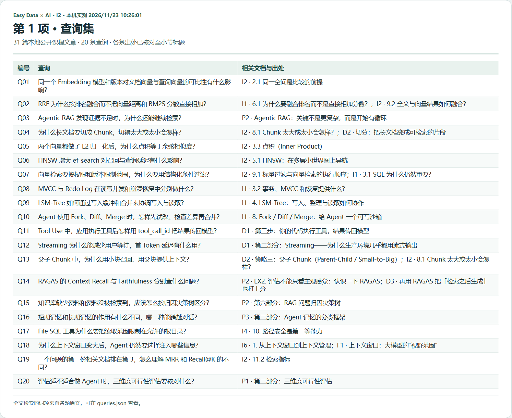
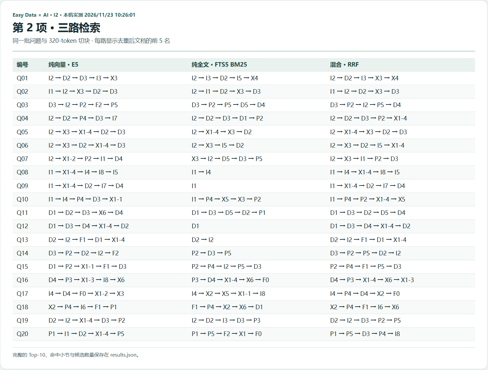
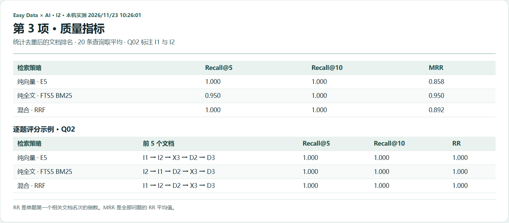
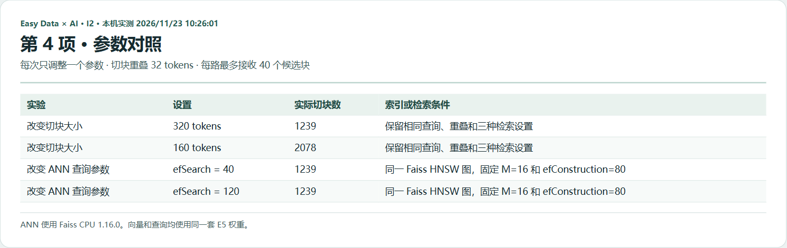
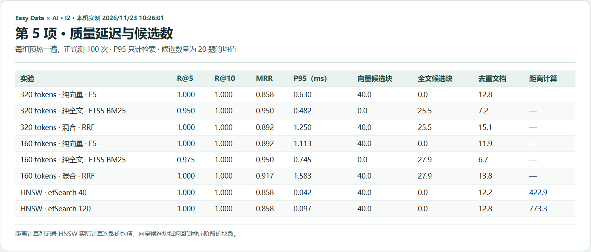
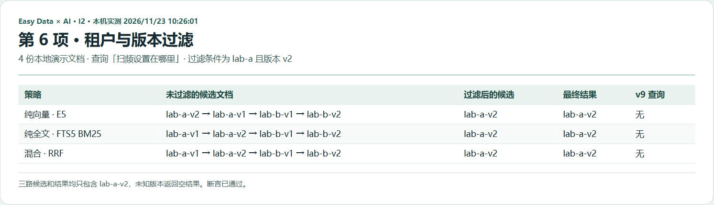
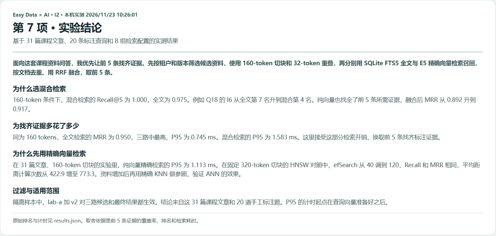

# I2 课后行动 · 检索评测完整记录

[返回 Task03 学习笔记](../README.md)

本次实验使用 31 篇公开课程文章和 20 条标注查询，在本机跑了 8 组检索配置。质量指标按去重后的文档排名计算。P95 从查询向量准备好之后开始计时。

## 1. 建立查询集

每条问题提前标注相关文档 ID 与原文小节，三路检索共用同一份标注。[20 条查询原始数据](queries.json)

## 2. 运行纯向量、纯全文和混合检索

用 E5 做精确向量检索、SQLite FTS5 做 BM25 全文检索，再用 RRF 融合两路排名。截图展示 320-token 基线中每题的前 5 个文档。

## 3. 统计 Recall@5、Recall@10 和 MRR

Recall 衡量找回多少标注证据，MRR 衡量第一份相关文档排得多靠前。下图包含三路平均指标和 Q02 的逐题评分。

## 4. 调整切块大小和 ANN 查询参数

切块从 320 调到 160 tokens，重叠固定为 32 tokens。ANN 对照固定 320-token 切块和同一个 Faiss HNSW 索引，对比 `efSearch=40` 与 `efSearch=120`。

## 5. 记录质量、P95 延迟和候选数

每个配置正式测量 100 次。较大的 `efSearch` 在这批查询上得到相同的 Recall 和 MRR，平均距离计算次数由 422.9 增至 773.3。

## 6. 验证租户和版本过滤

在四份隔离的演示文档上，指定租户 `lab-a` 和版本 `v2` 后，三路候选和最终结果都只包含 `lab-a-v2`。未知版本 `v9` 返回空结果。

## 7. 实验结论

面向这套课程资料问答，我优先让前 5 条找齐证据。先按租户和版本筛选候选资料，使用 160-token 切块和 32-token 重叠，再分别用 SQLite FTS5 全文与 E5 精确向量检索召回，按文档去重、用 RRF 融合，取前 5 条。

### 为什么选混合检索

160-token 条件下，混合检索的 Recall@5 为 1.000，全文为 0.975。例如 Q18 的 I6 从全文第 7 名升到混合第 4 名。纯向量也找全了前 5 条所需证据，融合后 MRR 从 0.892 升到 0.917。

### 为找齐证据多花了多少

同为 160 tokens，全文检索的 MRR 为 0.950，三路中最高，P95 为 0.745 ms。混合检索的 P95 为 1.583 ms。这里接受这部分检索开销，换取前 5 条找齐标注证据。

### 为什么先用精确向量检索

在 31 篇文章、160-token 切块的实验里，纯向量精确检索的 P95 为 1.113 ms。在固定 320-token 切块的 HNSW 对照中，efSearch 从 40 调到 120，Recall 和 MRR 相同，平均距离计算次数从 422.9 增至 773.3。资料增加后再用精确 KNN 做参照，验证 ANN 的效果。

### 过滤与适用范围

隔离样本中，lab-a 加 v2 对三路候选和最终结果都生效。结论来自这 31 篇课程文章和 20 道手工标注题。P95 的计时起点在查询向量准备好之后。

## 参考来源

| 来源 | 对应内容 |
| --- | --- |
| [Datawhale I2 · 向量数据库与 RAG](https://datawhalechina.github.io/easy-data-x-ai/industry/I2%20%E8%AF%BE%E7%A8%8B%E7%A8%BF%EF%BC%9A%E5%90%91%E9%87%8F%E6%95%B0%E6%8D%AE%E5%BA%93%E4%B8%8E%20RAG.html#课后行动) | 课后行动和评测要求 |
| [运行结果页 HTML 源文件](运行结果.html) · [原始结果](results.json) | 逐题排名、检索计时和过滤验证 |
