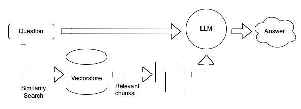

# Task03：理解 RAG 与向量检索

导出日期：2026-11-23（北京时间）

[P2 学习笔记](#p2--agentic-rag-产品设计) · [I2 学习笔记](#i2--向量数据库与-rag) · [I2 课后行动完整记录](I2-action/README.md)

## P2 · Agentic RAG 产品设计

### 第一部分： RAG 的常见误解

学习日期：2026-11-22

**RAG** ( Retrieval-Augmented Generation)，重点在第一个词：Retrieval（检索）。  
检索不是特指向量检索，而是**所有能把有效信息取回给模型的手段**，比如：

| 类型 | 适合 |
| --- | --- |
| 全文 / 关键词检索 | 错误码、版本号、产品名、专有名词 |
| 向量语义检索| 口语化提问、同义表达、模糊需求 |
| 标量 / 元数据过滤 | 按租户、时间、产品线、权限、文档类型做范围筛选 |
| 图谱 / 关系跳转 | 多跳关系问题 |
| API 工具调用 | 查实时搜索引擎结果等 |
**RAG 广义上就是系统生成前，先去外部获取信息给模型**，关注找什么，去哪找，何时找，怎么合并，能给谁看。

### 第二部分：传统 RAG 和 Agentic RAG，区别在哪儿？

学习日期：2026-11-22

- 传统 RAG 大多都是预先设计好的流程，一般是无环的  
- Agentic RAG 流程里面存在反馈等闭环，由系统自主决定下一步  
**借用我电子信息专业的内容，用信号与系统视角看**，传统的就是只有前向通路，而 Agentic 的则是有环路。后者的系统更为复杂，这样子能更好的调节系统，环路部分相当于引入的 ReAct，由 Agent 判断是否检索，检索那一方向，检索的是否理想，是否依赖前一次检查结果，以及不同来源结果的合并。  
**混合检索**  
很多情况下检索不是单一路径就能解决问题的，问题天然有多种信息需求，常见组合包括：

| 检索方式 | 解决 |
| --- | --- |
| 向量检索 | 怎么表达都能找到 |
| 全文检索 | 专有名词和精确信息必须找准 |
| 标量检索 | 只在正确范围内找 |
| API 工具调用 | 实时状态和结构化数据要直接查 |

### 第三部分：一个完整的 RAG，基础流程通常是怎么设计的

学习日期：2026-11-22

RAG 至少要有以下一条完整链路：  
数据准备（indexing） → 问题理解与改写（query analysis / transformation） → 搜索召回（retrieval） → 融合重排（fusion / reranking） → 回答生成（generation） → 评估反馈（evaluation）。  
前三步决定能不能找对，后散步决定能不能答对。

**1. 数据准备**  
需要面临以下问题

- 怎么加载（load）：产品文档、FAQ、工单、API 文档、内部 SOP、运营规则、数据库表、外部网页，哪些要纳入系统  
- 怎么解析（parse）：PDF、HTML、Markdown、表格、截图转录后的文本，如何转成可处理结构  
- 怎么清洗（clean）：去重、去噪、去过期、去模板垃圾，保留真正有信息密度的内容  
- 怎么切分（split）：按段落、章节、问答对、语义块还是结构块切分内容块（chunk）  
- 怎么增强（enrich）：补标题、章节、别名、术语、版本号、权限、时间等元数据  
- 怎么建索引（embed / index）：建立向量索引、全文索引、过滤索引，让内容真正变成“可被搜索”  
- 怎么更新（refresh）：全量重建、增量同步、定时刷新、事件触发  
**数据的准备决定了后面检索的质量。**

**2. 改写 & 路由**

问题获取后，系统要先做理解：

- 问题分析（query analysis）：识别问题意图，是问概念、步骤、对比、状态，还是实时数据  
- 实体抽取（entity extraction）：提取产品名、版本号、错误码、时间范围、客户类型等关键对象  
- 问题改写（query rewrite）：把口语问法转成更适合搜索的表达  
- 问题扩展（query expansion）：补别名、补同义表达、补隐藏条件  
- 问题拆解（query decomposition）：把复杂问题拆成多个子问题分别处理  
- 假设文档生成（HyDE）：先生成一段“假想答案 / 假想文档”，再用它增强语义搜索  
- 回退提问（step-back prompting）：先把具体问题抽象成更高层问题，再反过来帮助召回  
- 路径路由（routing）：判断应该走全文、向量、过滤、SQL，还是混合调用  
**即把用户的自然语言转译成系统能找到对应信息的与语言和路径**  
**3. 搜索召回**

**召回是为了防止漏掉有可能有用的证据**，经典做法包括：

- 向量召回（vector retrieval）：找语义相关内容  
- 全文召回（full-text retrieval）：找精确匹配内容  
- 标量召回（scalar retrieval）：限制产品、版本、权限、时间范围  
- 结构化查询（structured retrieval）：走 SQL、接口或业务系统，拿结构化或实时信息  
- 多表示召回（multi-representation retrieval）：先按摘要找、再回到原文；或先按子块找、再回到父文档  
- 父子检索（parent-child retrieval）：先用小块提高命中率，再回到更大上下文保留完整性

**4. 融合 & 重排**  
检索结果返回后，需要对结果进行处理：

- 结果融合（fusion）：把向量、全文、过滤、工具查询返回的结果合在一起  
- 去重（deduplication）：去掉重复内容和高度相似内容  
- 合并相似内容块（chunk merge）：把被拆散的证据重新拼回有意义的上下文  
- 重排序（reranking）：按真实相关性重新排序，而不只是按初始召回分数  
- 融合排序（RRF 等）：把多路检索结果做稳定融合，避免单一路径偏置  
- 可信度加权：把来源权威性、发布时间、权限范围一起纳入排序  
- 上下文压缩（compression）：只保留真正有用的信息，控制后续上下文长度  
这样子**使数据处理有效和有序**。

**5. 上下文组织与生成**  
最关键证据交给模型还要处理两个问题

- 上下文组装（prompt assembly）：按主题分组、按时间排序、按问题子任务拆分  
- 证据引用：要求回答给出来源，让用户知道每个结论来自哪里  
- 约束生成：信息不足时明确说不知道，避免模型硬编  
- 结构化输出：在需要时输出步骤、表格、JSON、结论摘要  
- 后处理（post-processing）：补格式、补引用、补安全规则、补业务规则  
**使之将找到的资料变成真正可用的回答**。

**6. 评估与反馈闭环**  
答完上线后，还需要追踪：

- 过程评估：哪些问题经常搜不到，哪些问题经常搜偏，哪些路径总是失败  
- 节点评估：改写是否有效、路由是否正确、重排是否稳定、压缩是否过度  
- 结果评估：哪些回答被用户点踩、追问或纠错  
- 来源分析：哪些来源高频命中，哪些来源长期无效，哪些来源噪音很大  
- 闭环优化：根据这些反馈回去补数据、改切分、补标签、调路由、换重排策略

这些反馈可用于后续的补数据等一系列修改。

### EX1\. 标准 RAG 流程上的常见增强节点

学习日期：2026-11-22

|类型 | 描述 | 优点 | 缺点 |
| --- | --- | --- | --- |
| Naive RAG | 最基础，就是正常的提问，检索，取回，拼接，回答流程 | 简单、便宜、容易落地 | 对 query 质量和单次召回质量非常敏感 |
| Query Rewrite RAG | 搜索前，先让模型把用户问题改写成更适合搜索的 query | 加在流程最前面，解决的是“用户会问，但系统不会搜”的问题 | N/A |
| CRAG（Corrective RAG） | 在检索之后、生成之前，先判断这批证据值不值得用 | 提升系统鲁棒性 | N/A |
| Self-RAG | 把“要不要检索”“检索结果够不够”“答案有没有证据支撑”这些判断，部分内化到模型自己身上 | 在流程里加入“自我检查”，不断修正反馈 | N/A |

### EX2\. 评估不能只看主观感觉：认识一下 RAGAS

学习日期：2026-11-22

**RAGAS** 的**核心价值**在于**为标准 RAG 流程里的中间过程和最终输出，建立了一组有参照系的评估方式。**  
RAGAS 有四类核心评估指标：

| 指标 | 阶段 | 描述 | 影响因素 |
| --- | --- | --- | --- |
| 上下文召回率（Context Recall） | 搜索召回阶段 | 该召回的证据，有没有被召回来 | 数据覆盖、数据准备、query 改写或搜索策略 |
| 上下文精确度（Context Precision）| 融合重排阶段 | 召回的上下文里，有多少是真正相关的，而不是噪音 | 混入噪音多少，重排或过滤处理 |
| 忠实度（Faithfulness） | 生成阶段 | 最终回答是否忠于给定上下文，有没有编造 | 模型幻觉、Prompt 约束、引用设计 |
| 答案相关性（Answer Relevancy） | 回答用户阶段 | 最终回答是否真正回答了用户问题，而不是答非所问 | 问题理解，或者虽然检索到了证据的回答组织 |

### EX3\. 从 RAG，到 Agentic RAG

学习日期：2026-11-22

Agentic RAG 就是在传统 RAG 上加入判断和编排：

- 加 query 改写：让系统更会搜  
- 加混合搜索：让系统能自适应地选择最优的搜索方式，并对不同搜索方式召回的结果进行融合重排  
- 加结果判别和重试：让系统知道“这次搜得不够好，需要补搜”  
- 加多轮编排：让系统可以先过滤、再搜索、再合并，而不是一步到位  
- 加工具调用和外部数据源：把“知识库问答”升级成“面向任务找信息”

### 第四部分：混合搜索，在 RAG 流程里的重要性

学习日期：2026-11-22

课程说是混合检索在 RAG 流程的作用，但更像是数据库本身自带或者支持混合检索的好处：  
1.同时服务传统 RAG 和 Agentic RAG  
在同一套底层里面支持向量语义检索，关键词/全文检索，标量过滤  
2.把复杂度内置，降低开发者负担  
自己做混合检索难度大，系统复杂，维护成本高，不同系统之间难以对齐。内置可用减少底层细节  
3.支撑 Agentic RAG 的闭环编排  
使用 Agentic RAG 的系统不用频繁做决策。

加入混合搜索影响的有：

- 搜索效果上限  
- 系统开发/运维复杂度  
- 响应延迟  
- 成本结构  
- 后续是否能从传统 RAG 升级到 Agentic RAG

### 第五部分：三层归因框架——“AI 答错了”的正确诊断方法

学习日期：2026-11-22

“AI 答得不好”的根因分为三层：  
 **第一层：数据层问题**

| 类型 | 原因 | 解法 |
| --- | --- | --- |
| 检索不到 | 内容覆盖或数据准备问题 | 补充知识库，或重做数据准备  |
| 检索错误内容 | 检索相关性或检索路径设计问题 | 改善检索策略，使用混合检索，混合搜索，或者优化文档分块、重排逻辑、query 改写逻辑  |

**第二层：模型层问题**

| 类型 | 原因 | 解法 |
| --- | --- | --- |
| 答案无中生有 | 模型幻觉 | 引用来源设计、约束生成， Prompt 工程和产品设计层面可以优化 |

**第三层：业务层问题**

| 类型 | 原因 | 解法 |
| --- | --- | --- |
| 答案正确，但不符合业务场景 | 回答风格或业务规则不匹配 | 优化 Prompt，补充业务规则 |

**大多数的问题处在数据层**

### 第六部分：RAG 问题归因决策树

学习日期：2026-11-22

**第一步：确认问题是什么。**  
不对的地方大致分为三种：

- 回答中有关键信息是错的或编造的  
- 回答太泛、太空、没有针对性  
- 回答的事实没问题，但不合规，或者回答的风格不适合这个场景（这个问题直接检查 Prompt 和业务规则设计）

**第二步：检查知识库中有没有正确答案。**  
人工检索知识库，看看有无答案，没有就补充，有则下一步。

**第三步：检查 AI 有没有检索到这些正确内容。**  
查看 AI 这次回答时，实际检索到的内容是什么，如果不正确，说明是检索策略问题，如果正确则下一步

**第四步：检查模型有没有正确使用检索到的内容。**  
模型是在正确内容的基础上添加了编造的信息（幻觉），还是没有充分利用检索到的内容？如果是编造了信息，就针对幻觉去处理，如果是没用充分利用检索到的内容，就检查 Prompt 设计。

### 总结和课后行动

学习日期：2026-11-22

RAG 重在检索，Agentic RAG 核心在于有无循环，评估根据流程走，混合检索是流程的底座。大多 RAG 问题都是数据层的问题。

5 个案例肯定有，但是没那么好找，我就直接让 gpt 帮我找一下之前符合不好标准的 5 次案例了

| 编号 | 问题 | 检查 | 结论 |
| --- | --- | --- | --- |
| 01 | 画图时圆极化方向图数据配对出错。 | 初版按曲线形状把实测 CR 配给仿真 LHCP，把实测 CL 配给仿真 RHCP。原始文件有 CL、CR 标签。 | 未利用原文件中的标签，匹配出错，**数据层 · 检索策略**。 |
| 02 | 历史任务拿不到 HFSS 原生图。 | 旧任务已有 `.rdat`，但 AEDT 插件缺少可选方法，报告恢复中止。改用兼容路径后，导出的 CSV 与旧候选曲线吻合。 | 已有证据未能被工具读出，**数据层 · 检索策略**。 |
| 03 | Agent 给了结果卡，用户仍不知道怎么选。 | 结果卡已展示，答复缺少候选推荐、指标依据和待确认条件。 | 交付缺少推荐说明，归为**业务层 · 输出规则**。 |
| 04 | S11 图统一网格后更难读。 | 固定网格尺寸后，双频和圆极化图被压矮，试导出的图缺少可见的 Y 轴标题。 | 验收需要覆盖图面比例和轴标题，归为**业务层 · 验收规则**。 |
| 05 | 搬工作区后，DSH 的 PDF 工具调用失败。 | PDF 和 Reader 都在新目录，启动配置仍指向旧目录。修正后，PDF 信息、正文和图片工具均返回成功。 | 工具从旧路径取证失败，归为**数据层 · 检索策略**。 |

#### 统计

| 层级 | 条数 | 比例 | 案例 |
| --- | ---: | ---: | --- |
| 数据层 · 内容覆盖 | 0 | 0% | — |
| 数据层 · 检索策略 | 3 | 60% | 01、02、05 |
| 模型层 · 已证实的幻觉 | 0 | 0% | — |
| 业务层 · 输出或验收规则 | 2 | 40% | 03、04 |

## I2 · 向量数据库与 RAG

### 1\. 从“不可比较”到“可计算”

学习日期：2026-11-22

**传统数据库擅长**处理可以明确量化对比，精确匹配的数据和关系。**即结构化和半结构化**  
但是图片、音频、视频和自然语言文档本身难以比较，缺乏天然的“相似度计算“，比如两张图的内容相似，但是二进制编码差异大。两句话表达同一个意思，但是用词不同。音频经过采样压缩，变得不一样，但是人仍然可能认为其内容相同。多模态的数据都是块存储或对象存储。  
Embedding 模型改把文本、图片、音频等对象转换为固定维度的数值向量，使“内容是否相似”近似转化为“向量在高维空间中是否接近”。这并不意味着向量理解了内容的全部含义。而是根据训练目标提取的潜在特征表示。

### 2\. Embedding：语义的数值表示

学习日期：2026-11-22

同一空间是比较的前提  
只有由兼容模型、相同版本和相同编码方式生成的向量，距离才通常具有可比性。  
以下做法会破坏检索：

- 文档使用模型 A，查询使用模型 B；  
- 模型升级后只重算新数据，没有重算历史数据；  
- 模型要求区分 query 与 document 输入，却对两者使用同一种提示格式；  
- 文本预处理、截断或归一化规则在写入与查询阶段不一致；  
- 向量维度与索引定义不匹配。  
所以向量旁边至少应记录

| 字段 | 作用 |
| --- | --- |
| embedding_model | 标识模型或逻辑模型名 |
| embedding_version | 支持升级、回滚和重建 |
| embedding_dim | 防止维度不一致 |
| content_hash | 判断原文是否变化、是否需要重算 |
| embedded_at | 追踪生成时间和数据新鲜度 |

向量不是事实本身，适合做候选召回，但不适合做唯一依据，因为其不可直接还原为完整原文，距离分数也不是事实正确性的概率，相似内容可能已过期或者无法访问，以及模型可能没有学到业务中的关键区分。  
因此，RAG 应同时保存原文、来源、版本、权限和结构化元数据。向量负责“找到候选”，原文负责“提供证据”。

### 3\. 距离与相似度：到底在比较什么？

学习日期：2026-11-22

选择距离函数不能只看数据库支持什么，还要与 Embedding 模型的训练方式匹配。常见的三种度量是欧氏距离、余弦相似度和点积。  
**A.欧式距离（L2）**

```math
d_{L2}(\mathbf{x},\mathbf{y})=\sqrt{\sum_{i=1}^{n}(x_i-y_i)^2}
```

L2 衡量两个点的绝对空间距离，**值越小越相似**。它既受方向影响，也受向量长度影响，**适合关注绝对数值差异，或模型明确以 L2 距离训练和评测的场景**。

**B.余弦相似度**

```math
\cos(\mathbf{x},\mathbf{y})=\frac{\mathbf{x}\cdot\mathbf{y}}{\lVert\mathbf{x}\rVert_2\,\lVert\mathbf{y}\rVert_2}
```

余弦相似度关注方向，弱化向量长度。常用于文本语义检索。

**C.点积（Inner Product）**

```math
\operatorname{IP}(\mathbf{x},\mathbf{y})=\sum_{i=1}^{n}x_{i}y_{i}
```

点积同时受方向和模长影响，值越大通常表示越相似。  
若向量已经做 L2 归一化，则点积与余弦相似度等价：

```math
\lVert\mathbf{x}\rVert_2=\lVert\mathbf{y}\rVert_2=1 \Rightarrow\mathbf{x}\cdot\mathbf{y}=\cos(\mathbf{x},\mathbf{y})
```

4.如何选择

| 情况 | 选择 |
| --- | --- |
| 模型文档明确指定距离函数 | 严格跟随模型说明 |
| 向量已归一化，关注方向 | 余弦相似度或点积 |
| 向量模长本身含有信息 | 点积或 L2，结合模型定义 |
| 比较二值特征 | 汉明距离或 Jaccard 距离 |
| 不确定 | 用标注查询集对不同度量做离线评测 |

分数阈值根据当前业务校准

### 4\. 最近邻搜索：从精确到近似

学习日期：2026-11-22

给定查询向量，在数据集中寻找最相似的 K 个向量，称为 K 近邻搜索（KNN）  
1.精确 KNN，就是直接计算每条向量的距离，再取 Top-K  
2.近似最近邻（ANN）不检查所有向量，利用图、聚类或量化结构缩小搜索空间，用**少量**召回**减少延迟**和获得明显**吞吐收益**。  
按业务需要选取，策略是有舍有得的

### 5\. 常见向量索引

学习日期：2026-11-22

**A.HNSW（Hierarchical Navigable Small World）** 把向量组织成多层邻接图：

1. 上层节点少，用于快速跳到大致区域  
2. 搜索逐层下降，不断靠近查询向量  
3. 底层更稠密，用于寻找最终候选

| 参数 | 影响 |
| --- | --- |
| M | 图的连接量，召回率变化，内存和构建成本 |
| ef_construction | 建图检索充分度，检索质量，构建速度 |
| ef_search| 检查候选量，召回率变化，查询速度 |

适合**低延迟、高召回**的内存型检索，吃内存，维护成本需要评估

**B.IVF（Inverted File Index）** 先把向量聚成若干中心：

1. 建索引时将向量分配到最近的聚类中心  
2. 查询时先找到最接近的若干中心  
3. 只在对应分区中搜索候选

| 参数 | 影响 |
| --- | --- |
| nlist | 聚类中心或分区数量 |
| nprobe | 扫描范围，召回率，延迟 |

适合**较大规模、批量构建和内存受限**场景，数据分布变化要重训练或重建索引

**C.量化**通过更紧凑的表示减少存储和计算开销：

- 标量量化（SQ）：降低每个向量元素的精度  
- 乘积量化（PQ）：把向量切成子空间，用码本近似表示  
- 二值量化（BQ）：将向量压缩为二值表示

适合**大规模和内存敏感**场景，会引入额外近似误差。  
**常见做法是用量化索引召回候选，再用原始向量精确重算候选分数。**

### 6\. 向量数据库到底存什么？

学习日期：2026-11-22

合理的数据模型包含四类信息：

| 类型 | 示例 | 用途 |
| --- | --- | --- |
| 原始证据 | 	content、title、source_url | 生成答案和展示引用 |
| 向量 | 	embedding | 语义召回 |
| 业务元数据 | 	tenant_id、department、status | 	权限与业务过滤 |
| 数据治理信息 | doc_version、chunk_no、content_hash | 更新、追踪、去重和重建 |
查询时在业务条件内找相似，向量回答哪些内容和问题接近，标量则表明哪些内容属于当前业务范围且允许访问。

### 7\. RAG：检索增强生成

学习日期：2026-11-22

**这部分和之前的有重合**，RAG（Retrieval-Augmented Generation）在**生成答案前**，从**外部知识库检索证据**并放入模型上下文。它主要缓解三类问题：

- 模型训练数据不包含企业私域知识  
- 模型知识存在时间截止点，无法自动获取最新事实  
- 仅依靠模型参数生成，答案难以追踪来源

A.离线入库流水线  
需要保证幂等性。相同的文档重复处理不应产生无法追踪的重复块；文档的删除、更新、权限变化和模型升级要有应对的数据维护策略。  
B.在线查询流水线  
如果最终答案错误，应该按照下图链路定位问题



### 8\. Chunking：切分决定可检索的最小单元

学习日期：2026-11-22

模型上下文有限，生成覆盖全文的向量也不适合，所以要切块，这里我感**觉和 token 的分词器类似**  
Chunk 切太小就使结果语义不完整，上下文断裂，召回结果碎片化，切太小则内容混杂，信息被稀释，占用上下文。切得重叠过少，关键语义就可能被切在边界，但是重叠过多索引就会膨胀，重复召回，浪费上下文。  
应对策略有：

- 按固定 Token 数切分并设置 overlap  
- 按标题、段落、列表、代码块等文档结构切分  
- 根据句子间语义变化寻找边界  
- 使用父子 Chunk：小块负责召回，大块负责返回上下文

Chunk 入库时应保留：

- 文档与父 Chunk 的标识  
- 标题路径和章节层级  
- 页码、段落号或代码行位置  
- 原始来源与版本  
- 权限和生效时间  
- 前后邻接关系

### 9\. 纯向量检索为什么不够？

学习日期：2026-11-23

这里也有类似重复内容，向量检索只适合语义近似，精确内容需要全文检索或者标量过滤的混合检索。  
标量过滤的过滤条件选择率会影响最佳执行方式

| 策略 | 	过程 | 适用情况  | 风险 |
| --- | --- | --- | --- |
| 过滤后精确计算| 先过滤，再对剩余向量全量算分 | 过滤后数据很少 | 条件不够严格时延迟高 |
| 向量优先再过滤 | 先召回较多候选，再做标量过滤 | 过滤选择率高 | 过滤后可能不足 K 条 |
| 过滤下推 ANN | 将允许集合下推到向量索引 | 多种选择率与复杂权限 | 实现和优化器更复杂 |
全文和向量结果通过 RRF 按照名次融合。

### 10\. 重排与上下文组装

学习日期：2026-11-23

- 双编码 Embedding 模型可以分别计算查询和文档向量，文档向量可提前离线生成，因此适合从海量数据中快速召回。  
- Cross-Encoder 或重排模型通常让查询和候选共同参与计算，判断更细致，却无法为任意查询提前算好结果，成本更高。

因此是分两阶段检索，先低成本召回大量数据，然后模型精排选取少数数据注入上下文。

进入 LLM 前，还应做以下处理：

- 相同文档或相邻 Chunk 去重  
- 命中子块后扩展父块或邻接块  
- 按文档、章节或时间恢复合理顺序  
- 控制每个来源占用的 Token  
- 保留来源、版本与定位信息  
- 避免把检索到的文档指令当作系统指令执行（Prompt Injection 防护，知识库文本是不可惜数据，不应有系统权限）

### 11\. 如何评测向量检索与 RAG？

学习日期：2026-11-23

评测至少分为检索层、生成层和系统层。  
评测集应覆盖高频问题、长尾问题、专有名词、错误码、跨段信息、无答案问题、权限隔离、时间敏感内容和对抗输入。  
检索指标:  
**Recall@K**:所有相关文档中，有多少出现在前 K 条结果：

```math
Recall@K=\frac{\lvert TopK \cap Relevant \rvert}{\lvert Relevant \rvert}
```

**Precision@K**：前 K 条结果中，有多少是真正相关：

```math
Precision@K=\frac{\lvert TopK \cap Relevant \rvert}{K}
```

**MRR**：关注第一个相关结果出现的位置：

```math
MRR=\frac{1}{\lvert Q \rvert} \sum_{q \in Q}\frac{1}{rank_{q}}
```

若相关性有相关的等级，则可以使用**nDCG@K**：

```math
nDCG@K=\frac{DCG@K}{IDCG@K}
```

其中 DCG@K 和 IDCG@K 分别为：

```math
DCG@K=\sum_{i=1}^{K}{\frac{2^{rel_{i}}-1}{\log_{2}{i+1}}}
```

```math
IDCG@K=\sum_{i=1}^{K}{\frac{2^{rel_{i}^{*}}-1}{\log_{2}{i+1}}}
```

其中 $`{rel_{i}}`$ 表明第 $`i`$ 个结果的相关等级； $`\log_{2}{i+1}`$ 表明位置折扣，越靠后权重越低；K 表明只看前 K 个结果。 $`{rel_{i}^{*}}`$ 表明是理想顺序的第 $`i`$ 个结果。

RAG 的最终答案还应评估：

- **忠实度**：结论是否由检索证据支持  
- **答案相关性**：是否直接回答用户问题  
- **引用准确性**：引用是否真的支持对应陈述  
- **完整性**：关键要点是否遗漏  
- **拒答能力**：没有证据时能否明确说明不知道

系统指标还应观察：

- P50、P95、P99 延迟（P50 表示 50%的请求小于该值，即中位数延迟，P95 表明较慢延迟，P99 表明尾部延迟）  
- 查询吞吐和并发稳定性  
- Embedding 与重排调用成本  
- 索引构建时间和资源占用  
- 写入后索引可见延迟  
- 超时率、降级率与缓存命中率  
- 不同租户和权限条件下的正确隔离

### 12\. 专用向量数据库，还是数据库向量扩展？

学习日期：2026-11-23

业界有大致两条路线：

- 专用向量数据库：围绕向量存储、ANN 索引和分布式检索设计  
- 在现有数据库中扩展向量能力：把向量检索与原有事务、SQL、全文和标量查询结合

选型需要考虑的维度有数据规模；查询负载；写入负载；混合查询；一致性；多租户安全；部署和团队成本

评估路线的适宜情况：

| 评估专用系统 | 评估统一数据库 |
| --- | --- |
| 向量检索本身是核心负载，规模与吞吐非常高 | 业务数据与向量、全文和权限过滤紧密耦合 |
| 需要某种专用索引、异构计算或成熟的向量生态 | 希望使用 SQL、事务、Join 和既有驱动生态 |
| 数据同步和权限治理已有可靠平台承接 | 数据规模中等，更关注开发与运维复杂度 |
| 团队能够独立运维额外的分布式系统 | 需要减少跨系统复制和一致性窗口 |
| N\A | 应用希望在嵌入式与服务器形态间迁移 |

选择系统之前，先明确工作负载和验收指标

### 常见误区解答

学习日期：2026-11-23

向量数据库的核心对象是向量及其元数据。原始大文件常保存在对象存储或文件系统中，数据库保存可检索表示、定位信息和必要正文。  
相似只表示模型空间中的接近程度，不代表内容权威、最新、有权限或能支持答案。  
只看延迟可能以牺牲召回为代价。必须在相同 Recall 目标下比较性能。  
过多候选会增加重排成本和上下文噪声，还可能让真正证据被淹没。Top-K 应通过评测确定。  
模型变化可能导致维度、向量空间和分数分布变化，通常需要版本化、全量重算、索引重建与回归评测。  
RAG 提供外部证据，但检索可能漏召回，模型也可能误读或忽略证据。仍需引用、验证、拒答和持续评测。

### 总结和课后行动

学习日期：2026-11-23

- Embedding 把非结构化内容变成可进行相似度计算的向量  
- 距离函数必须与模型训练方式和向量归一化策略一致  
- ANN 用一定召回损失换取可扩展的检索性能  
- 生产 RAG 需要向量、全文、标量过滤、融合和重排共同工作  
- 检索质量、生成质量、延迟、成本和安全必须分别评测  
- 向量数据库选型应由真实工作负载决定，而不是由产品标签决定

虽然 L 部分的课程都很让我说不出来，就感觉笔记是想要按照自己的话说，最后发现还是课程给的描述好一点，我不想复制粘贴，但是没有办法，这让我感觉我很难学到东西。没有好的解释，太多混乱的教学安排，让初学者非常难受。感觉就是全文在在强调数据，那么以此为例子，感觉全文给我的数据就是残缺不全同时没有做好数据处理的，该将的提一句就过了，没有太多意义的内容有些缺重复了好多次，让我反思这么做的意义是什么。  
总之之后我感觉如果我认为没必要去详细了解的内容，我就不做太多笔记了，过于浪费精力和时间，之后有需要再学，课程本身一开始就说了三篇的内容是面向不同学习者的，但是公开学习的打卡却要求都做，没有人是全能的，但是我也不能对一个公共的课程要求对我定制化，我只能按照自己需求做取舍了。

同时我觉得这个课后行动有点太变态了，这个数据库怎么获得，也应该说一下吧，对于没有这方面经历的来说太过于困难了。或者提供一下小的数据库样本。最后我是让 gpt 帮我搞的，因为我制作的笔记本身也是按照数据库的形式搭建的，但是做起来真的不是很舒服。这个结果会随本篇笔记上传。

**思考题**

1. 为什么同一批向量换一种距离函数后，排序可能完全不同？  
因为距离函数就是算向量间的距离的，换了距离函数，算法都变了，距离远近的结果就不一样，当然会变得不同  
2. 精确 KNN 为什么仍然是 ANN 评测的重要基线？  
ANN 再怎么说也是近似的算法，评测还是需要精确的 KNN 才能正确衡量  
3. “先向量检索再做权限过滤”会产生哪些正确性和安全问题？  
正确性问题有先检索了，再过滤，那么可能先检索的都是无权限的内容，之后都被过滤了，最后要考虑的都是先检索中的有多少是有权限可用的，但是显然效果不行。  
安全问题是没有先权限过滤控制，检索过程中其他人也可以看到你的检索，造成泄露。  
4. 为什么 Embedding 模型升级通常需要重建历史向量？  
升级后距离，向量等都可能变化，需要重新适配。  
5. 检索 Recall 提升后，最终答案质量为什么可能没有同步提升？  
Recall 只是影响召回率，最终回答质量取决于召回的精度等条件。  
6. 你的场景中，专用向量数据库的收益是否足以覆盖新增系统成本？  
不足以，目前的数据库就是自己定制的不需要再新增系统了

## I2 课后行动实测

[查看 7 项实验、截图与结论](I2-action/README.md)。实验使用课程公开语料，由 AI 辅助运行和整理。

## 参考来源

| 来源 | 用途 |
| --- | --- |
| [Datawhale P2 · Agentic RAG 产品设计](https://datawhalechina.github.io/easy-data-x-ai/pm/P2%20%E8%AF%BE%E7%A8%8B%E7%A8%BF%EF%BC%9AAgentic%20RAG%20%E4%BA%A7%E5%93%81%E8%AE%BE%E8%AE%A1.html) | Agentic RAG、混合搜索和问题归因 |
| [Datawhale I2 · 向量数据库与 RAG](https://datawhalechina.github.io/easy-data-x-ai/industry/I2%20%E8%AF%BE%E7%A8%8B%E7%A8%BF%EF%BC%9A%E5%90%91%E9%87%8F%E6%95%B0%E6%8D%AE%E5%BA%93%E4%B8%8E%20RAG.html) | 向量检索、评测方法与课后行动 |
