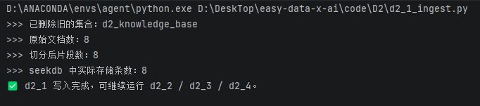
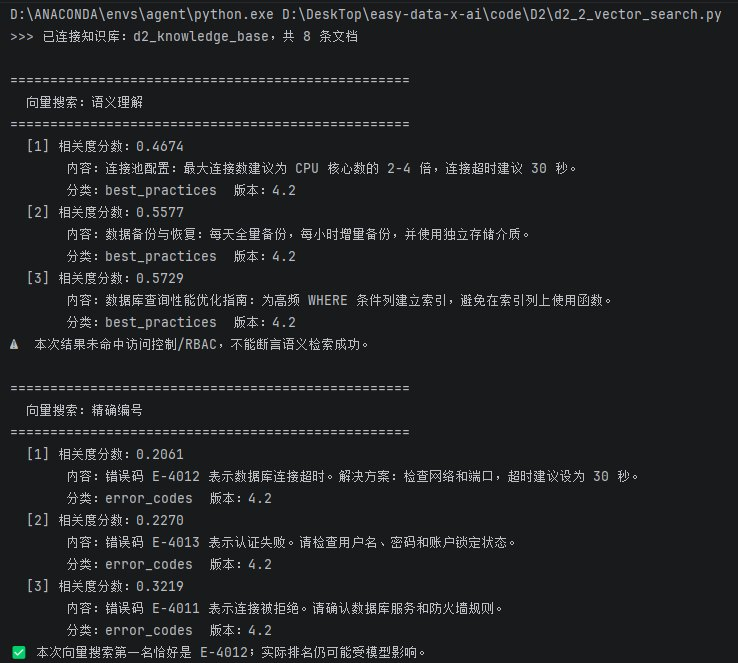
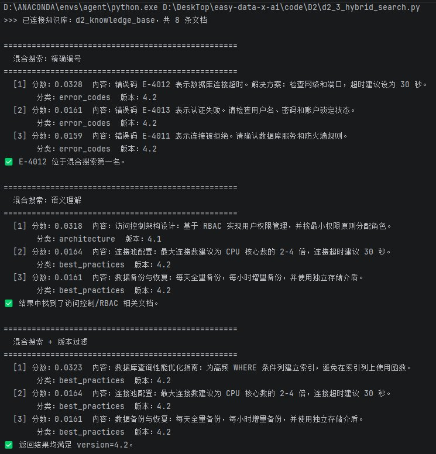
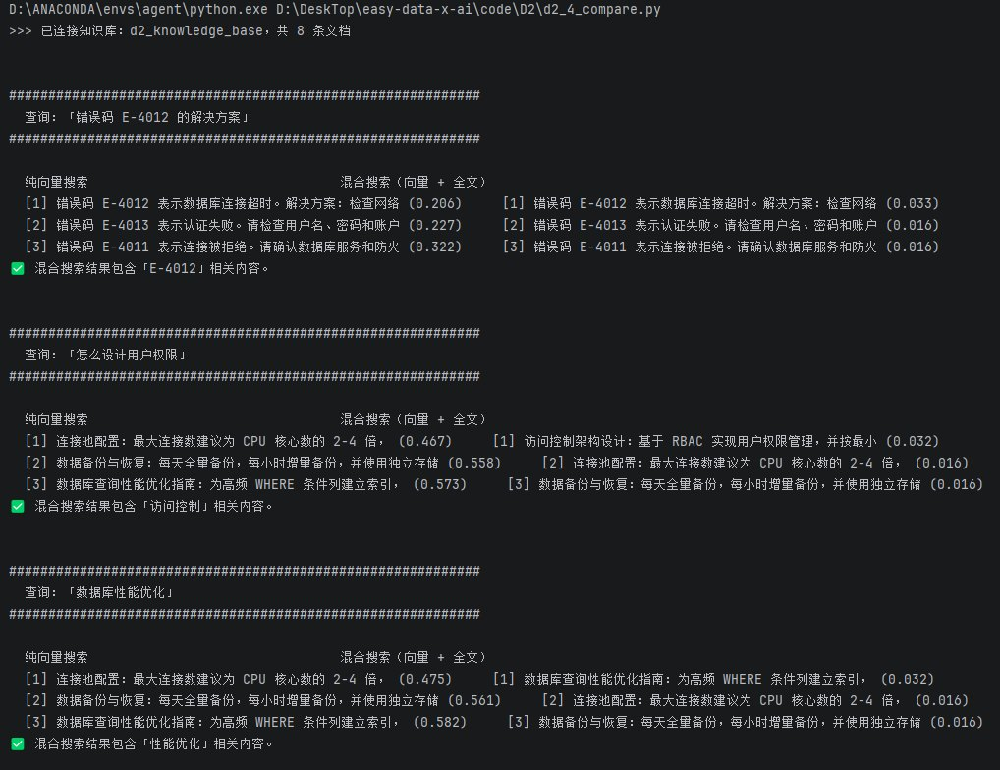
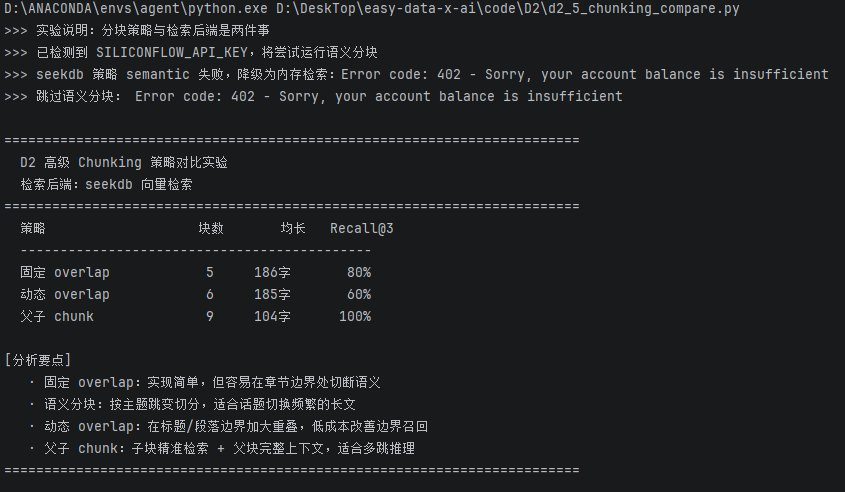
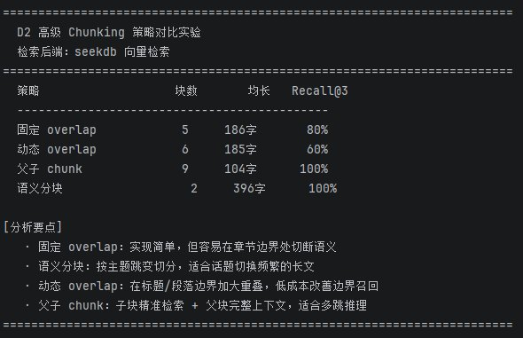
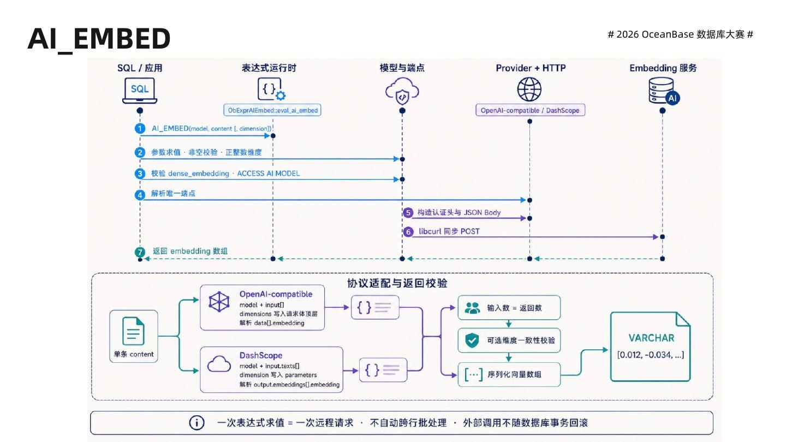
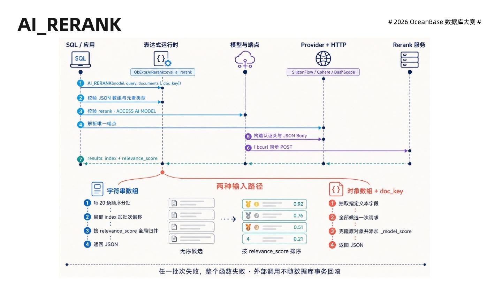
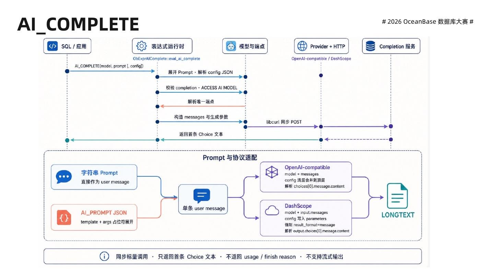

# Task04：搭建数据层，走近 SQL × AI

导出日期：2026-11-25（北京时间）

[D2 学习笔记](#d2--ai-应用的数据层) · [D2 课后行动](D2-action/README.md) · [I3 学习笔记](#i3--sql--ai) · [I3 课后行动](I3-action/README.md)

## D2 · AI 应用的数据层

### 数据进库之前——切分与向量化

学习日期：2026-11-24

原始文档通过**切分（Chunking）** 和 **向量化（Embedding）** 2 步变成可以被检索的数据。  
切分就是把长文档变成**可检索的语义完整的小片段**，切分有几个实用的原则如下：

- **按语义边界切**，优先在段落、标题处切，不要在句子中间断开  
- **片段不要太长**，500~800 字是常见范围，太长语义稀释，太短上下文不足  
- **保留重叠**，相邻片段保留 50~100 字的重叠，避免关键信息落在边界  
- **保留元数据**，每个片段记录来源文档、章节、更新时间等，用于后续结构化过滤

但是上述方法对于**大**的数据库容易遇到**检索召回正确，但是上下文不够**或者**相反情况**。以下是一些处理策略：  
**策略一：语义分块（Semantic Chunking）**  
就是先**按照句子来切开**，给每个句子算 Embedding，比较相邻句子的余弦相似度。当出现相似度“异常下跌”，表明话题转变，可以将前后句子切到不同 chunk。稳妥的判断下跌做法是用**percentile 阈值**——把文章所有相邻句的相似度按照跌幅排序，取第 95 分为作为切分线，即只有跌幅在全文前 5%才算跳变。实际情况在 90-95 间微调。  
语义分块适用于**结构不清晰、话题跳跃**的**长文**，作为 **“基础分块效果不够好”** 时的优化手段。但是这样每个句子入库都要调用一次 Embedding API，**开销比较大**。  
**策略二：动态 Overlap（Dynamic Overlap）**  
文章的语义密度各处不同，统一重叠容易丢失重要信息。动态 overlap 的做法是保持 chunk 大小基本不变，但根据内容特征动态调整重叠量：

| 区域类型 | 	overlap 策略 | 原因 |
| --- | --- | --- |
| 同质段落内部 | 较小 overlap（如 10%） | 减少冗余，降低存储和检索噪声 |
| 段落边界、标题行附近 | 较大 overlap（如 25–30%） | 保护跨边界的完整语义 |
| 代码块、表格前后 | 适当加大 overlap | 避免结构信息被切断 |

动态 overlap 的适用的是**已经有固定大小分块、不想引入 Embedding 额外开销，但边界召回率不理想**的场景。这是三种策略里**性价比最高**的策略。  
**策略三：父子 Chunk（Parent-Child / Small-to-Big）**  
相比前两个处理怎么切，该策略处理另一个问题：

- 小块检索精准，但塞给 LLM 时上下文不够——半句话说不清来龙去脉  
- 大块上下文完整，但向量语义被”稀释“，检索时找不到精确片段

父子 chunk 的核心思路是**把索引粒度和返回粒度解耦**，查询时用子 chunk 做向量检索，命中后取 parent_id，返回父 chunk 给 LLM，父 chunk 下面包含多个子 chunk，本身不建立向量索引。这里借用课程的图：

```
原始文档
  └── 父 chunk（500 字，存入 docstore，不建向量索引）
        ├── 子 chunk A（120 字，建向量索引）
        ├── 子 chunk B（120 字，建向量索引）
        └── 子 chunk C（120 字，建向量索引）

```

这套做法叫做 **small-to-big retrieval**（检索用小块、生成用大块）或 **parent-document retrieval**（按父文档返回上下文），把**检索什么和给 LLM 什么分开**。代价时 LLM 侧的 token 消耗随父块大小同比增加。

### 向量化：把文字变成数字

学习日期：2026-11-24

切分完成后，每个片段需要通过 Embedding 模型转换为一串浮点数的向量，代表这段文字的语义位置。Embedding 模型可以不自己训练，直接调用 API 即可。  
模型的选型方式，搞懂 2 个评测概念

- **MTEB** 排行榜（Massive Text Embedding Benchmark），目前最权威的 Embedding 模型公开评测。它把模型放到检索、分类、聚类、语义相似度等上百个标准任务上跑分，然后给出综合排名。做 RAG 检索时，重点看 Retrieval 子任务的得分，不要只看总分。局限：**主要测纯文本、短文本**，不覆盖多模态检索、跨语言检索、维度压缩（MRL）和长文档大海捞针等生产场景，所以排行榜**适合缩小候选范围**。  
- **Recall@K** 对比是更**贴近业务的**验证方式。准备条真实业务查询，标注每条查询应该命中的文档（Ground Truth），分别用不同 Embedding 模型做检索，看正确答案出现在前 K 条结果里的比例。通常同时看 Recall@1（最严格，看第一条是否命中）和 Recall@5（更宽松），以及 **MRR**（第一个正确结果排在第几位，排得越靠前越好）。

MTEB 反映的是通用能力，Recall@K 反映的是业务数据上的实际效果。  
确定评测方法后，按照四个维度缩小候选范围：

- 中英文能力  
- 多模态支持  
- 成本  
- 延迟

值得注意的有，多模态中的**模态间隙（Modality Gap）**，衡量文本向量和图片向量在同一个向量空间里是否足够接近。间隙越小，图文混合检索越准确。**多模态 Embedding 不能替代混合搜索**。：精度、存储、检索速度三者不可兼得，部分模型支持**MRL 降维**（Matryoshka Representation Learning）在精度损失可控的情况下降低存储开销。延迟则看调用的是否是海外 API 或者自部署，本地有无 GPU 等。  
**入库和查询必须用同一个模型**，查询和文档的编码方式可能不同，用以区分角色等。许多模型库支持多种检索方式。**RAG 的常见架构是 Embedding 负责初筛，Reranker 负责精排**。缓存和批量处理能省成本。

### 第一部分：传统数据库为什么不够用

学习日期：2026-11-24

传统数据库的设计是精确匹配。但是当用户使用自然语言描述时，常常给出的并不是可以精确匹配的条件，这需要的是予以适配

### 第二部分：向量检索，没有想象的聪明

学习日期：2026-11-24

为解决语义匹配问题引入了**向量检索**，通过 Embedding 模型（或者大模型）将文字转为一串数字的**高维向量**。意思相近的文字，向量也相近，查找**语义相近**就变成查找**向量空间中相近**的几个点。  
但是向量检索**不能实现精确检索**，向量空间里的相近可能让模型认为是语义上差不多的，只给出相近结果。

### 混合搜索

学习日期：2026-11-24

向量搜索擅长语义理解但搞不定精确匹配，而传统的全文搜索（关键词匹配）擅长精确匹配但不懂语义。所以结合二者，就是**混合搜索（Hybrid Search）**的核心逻辑：

- 向量搜索负责语义理解：“找意思最接近的内容”  
- 全文搜索负责关键词匹配：“找包含这个确切词的内容”  
- 关系过滤负责结构化条件：按版本/时间筛选

### 如何实现好的混合检索

学习日期：2026-11-24

目前行业中最常见的做法是这样的：

- 用一个向量数据库（比如 Pinecone、Milvus）做语义检索  
- 用一个搜索引擎（比如 Elasticsearch）做全文检索  
- 用一个关系数据库（比如 PostgreSQL）做结构化查询和数据管理

但是三个检索的协调困难，需要三个系统、三套部署、三套运维、三套 API、三个数据同步流程。结果需要合并，并可能重复或者检索残缺。所以 AI 应用的数据层不应该是三个系统拼在一起，**正确的做法是在一个系统里原生支持三种检索能力。** 在创建数据集合时，同时声明向量索引和全文索引，查询时就可以同时执行三种检索的效果。

### d2\_1

学习日期：2026-11-24

实现截图



### d2\_2

学习日期：2026-11-24

实现截图



### d2\_3

学习日期：2026-11-24

实现截图



### d2\_4

学习日期：2026-11-24

实现截图



### d2\_5

学习日期：2026-11-24

实现截图



注意 deepseek 没有支持 embedding 的 API，所以本次执行使用硅基流动的 API，但是硅基流动的 API 额度用完了，我让 GPT 帮我本地部署了 E5 来执行，结果如下



### 总结和课后行动

学习日期：2026-11-24

Agent 的每一项能力，拆到底都是数据的存储与检索。

课后行动  
1.所有代码已跑通。

| 要找的文档 | 纯向量 Top 5 | 纯全文 | 混合检索 |
|---|---:|---|---:|
| `E-4012` 解决方案 | 第 1 | 只命中 `E-4012` | 第 1 |
| 用户权限／RBAC | **第 5** | 只命中 RBAC 文档 | **第 1** |
| 数据库性能优化指南 | 第 3 | 只命中性能优化指南 | 第 1 |

2.跑分块对比实验：  
主要是看 Recall@3 的结果，动态覆盖的效果是最差的，父子 chunk 的效果最好，即使其切块更细，固定切块覆盖的效果反而比动态的好，语义分块虽然分块小，但是结果也很进准。我对比了数据库总结原因，**语义分块基本上交回了完整内容**，所以自然结果没什么问题，父子 chunk 只有 2 个父块，但是**排名前三的子块中即使没有命中关键词，也可能被扩展回来的父块带上**，返回的内容实际也是相当完整，所以效果最好，动态的 overlap 相比固定的，按理来说应该更好，但是可能是总共就 5 组数据，同时取前 3 个，切块导致了细小差异，总体这两者表现差不多。

3.换成自己的数据：  
虽然比起 I 篇正常多了，但是还是有难度，没有教这么存，这一步还是借助了 gpt。结果会随本次笔记上传。

[查看 D2 课后行动：电子资料的向量、全文和混合检索对照](D2-action/README.md)

## I3 · SQL × AI

### 1\. 为什么要让 SQL 调用 AI？

学习日期：2026-11-25

在应用层，传统 AI 应查询数据库通常是把行动转换为模型请求，然后调用Embedding/Rerank/LLM SDK，之后去解析响应，与原始行重新关联，最后写回数据库。  
虽然灵活，但是随着链路增长，代码会分散复杂。  
AI Functions 提供了另一种方式：先用 SQL 精确选择数据，再把有限输入交给外部模型，模型结果继续参与 SQL 表达式、JSON 处理、向量检索或结果写回。这不是取消应用层，而是缩短“数据选择—模型调用—结果处理”的距离。让数据库和应用或工作流分工。

总结下来，就是让 SQL 调用 AI 来负责将查到的数据与模型交接，并接受结果。而不是外部应用负责。这样就少写数据搬运和对接代码。所有筛选、调用和对应原始记录可以在同一条数据流程里完成。但是**想要 Agent 边查边问、边回答边显示，这些交互，用应用层更顺手，而靠近数据库，规则明确的处理适合 SQL AI**。二者实际可以结合使用。

### 2\. AI 函数不是普通标量函数

学习日期：2026-11-25

借用课程的代码

```sql
SELECT UPPER(title) FROM documents;
SELECT AI_COMPLETE('summary_model', content) FROM documents;
```
代码相似但是执行语义完全不同

| 维度 | 普通本地函数 | 远程 AI 函数 |
| --- | --- | --- |
| 执行位置 | 数据库进程内 | 外部模型服务 |
| 延迟 | 通常微秒到毫秒 | 常为数十毫秒到数秒 |
| 确定性 | 相同输入通常相同输出 | 	可能受模型、参数和服务状态影响 |
| 失败方式 | 类型或计算错误 | 还包括网络、限流、超时和协议错误 |
| 成本| CPU、内存和 I/O | 还包括 Token、请求或算力费用 |
| 事务回滚 | 计算本身无外部副作用 | 已发生的推理和计费不能回滚 |

第一条代码是**普通的 SQL 函数**，没用上 AI，而第二条是**SQL 的 AI 函数**，数据库将正文发送给模型服务，等模型生成摘要，再将摘要放入查询结果。

### 3\. 四个核心函数

学习日期：2026-11-25

| 函数 | 输入 | 返回 | 是否调用外部服务 |	典型用途 |
| --- | --- | --- | --- | --- |
| AI_EMBED | 模型名、文本、可选维度 | 向量数组文本 | 是 | 文档和查询向量化 |
| AI_RERANK | 模型名、查询、候选、可选字段名 | JSON | 是 | 对有限候选集精排 |
| AI_COMPLETE | 模型名、Prompt、可选生成参数 | 长文本 | 是 | 摘要、抽取、分类、问答 |
| AI_PROMPT | 模板与参数 | Prompt JSON | 否 | 模板化组装 Prompt |

AI_EMBED、AI_RERANK 和 AI_COMPLETE 是长得像 SQL 函数的远程网络调用。而 AI_PROMPT 只在本地组装 Prompt JSON，不访问模型服务。函数名只是入口，真正决定外部行为的还有逻辑模型、端点、Provider、物理模型名和调用参数。

### 4\. 一次 AI 函数如何执行？

学习日期：2026-11-25

一次远程 AI 函数调用通常经历：

1. 参数求值：读取常量、列、子查询或 JSON 表达式  
2. 类型与值校验：检查参数数量、NULL、空值和 JSON 结构  
3. 模型解析：根据逻辑模型名取得模型类型与服务侧模型名  
4. 权限检查：确认当前用户有权访问 AI 模型  
5. 端点解析：取得 URL、Provider、凭据和请求模型名  
6. 协议适配：构造认证头和 Provider 对应的 JSON Body  
7. HTTP 调用：同步请求外部模型服务并执行条件重试  
8. 响应解析：从 Provider 响应中抽取向量、分数或文本  
9. 返回 SQL：结果进入当前 SQL 上下文，继续被处理

该执行链路也说明了 AI 调用可能因 SQL 输入、模型配置、权限、网络、限流、响应协议等不同层次失败。

### 5\. 模型与端点为什么分开？

学习日期：2026-11-25

SQL 使用逻辑模型名，例如 doc_embedding，而不是把 URL、密钥和物理模型名写进每条查询。  
逻辑模型结构如下：

```sql
CALL DBMS_AI_SERVICE.CREATE_AI_MODEL(
  'doc_embedding',
  '{
    "type": "dense_embedding",
    "model_name": "your-embedding-model"
  }'
);
```
也就是说**模型和函数是匹配的**，如果模型和函数不匹配，数据库应远程请求前拒绝。

| 模型类型 | 对应函数 |
| --- | --- |
| dense_embedding | AI_EMBED |
| rerank | AI_RERANK |
| completion | 	AI_COMPLETE |

服务端点把逻辑模型映射到实际服务：

```sql
CALL DBMS_AI_SERVICE.CREATE_AI_MODEL_ENDPOINT(
  'doc_embedding_endpoint',
  '{
    "ai_model_name": "doc_embedding",
    "scope": "all",
    "url": "https://model.example.com/v1/embeddings",
    "access_key": "<MODEL_API_KEY>",
    "provider": "OPENAI",
    "request_model_name": ""
  }'
);
```
分离模型和端点带来三个好处：

- SQL 使用稳定的业务逻辑名  
- 运维可以更换 URL、凭据或网关路由  
- Provider 适配逻辑不必散落在业务 SQL 中

但是配置变化仍可能改变结果分布，更换 URL 或者模型名都应做相应处理。

### 6\. AI\_EMBED：把文本变成向量

学习日期：2026-11-25

借用课程的图较为直观展示


AI_EMBED 的使用方式为：

```sql
AI_EMBED(model_name, content [, dimension])
```

入库时会生成文档的向量，而查询时会生成一次查询向量。将查询向量先存入变量的原因是避免同一语句多处重复求值，从而重复调用模型服务。  
 **dimension 不只是提示**，可选维度参数[ , dimension ]通常既会发送给 Provider，也会用于检查返回向量长度。若模型忽略维度参数并返回默认长度，数据库仍可能因长度不一致而报错。因此：

- 模型不支持动态维度时省略该参数  
- 向量列、索引和 Embedding 模型的维度必须一致  
- 模型升级后不要把不同向量空间混入同一索引

当前标量表达式不会自动把多行文本聚合成一个 Embedding 批请求，所以是一行一次调用。**稳定文档向量更适合在写入流水线或受控任务中生成并持久化，而不是在每次查询时重算。**

### 7\. AI\_RERANK：从候选召回到语义精排

学习日期：2026-11-25

依旧借用课程的图：



AI_RERANK 的使用方式为：

```sql
AI_RERANK(model_name, query, documents [, doc_key])
```

具体示例

```sql
SELECT AI_RERANK(
  'doc_reranker',
  'seekdb 的 AI 函数有哪些？',
  JSON_ARRAY(
    'AI_EMBED 将文本转换为向量',
    'AI_RERANK 对候选文档进行重排',
    'AI_COMPLETE 调用生成模型'
  )
) AS reranked;
```

返回的结果是 json 格式的，通常包含原始位置和相关性分数

```json
[
  {"index": 1, "document": {"text": "..."}, "relevance_score": 0.96},
  {"index": 0, "document": {"text": "..."}, "relevance_score": 0.82}
]
```
对象数组可以保留业务字段：

```sql
SELECT AI_RERANK(
  'doc_reranker',
  'AI SQL 技术架构',
  JSON_ARRAY(
    JSON_OBJECT('id', 101, 'title', 'AI 函数', 'content', '...'),
    JSON_OBJECT('id', 102, 'title', '向量检索', 'content', '...')
  ),
  'content'
) AS reranked;
```
数据库提取每个对象的 content 发送给模型，再根据模型返回的 index 把分数关联回原对象。这样 ID、标题、来源和权限标签不会在重排过程中丢失。

**Rerank 适合处理召回后的几十到几百条候选**，而不是全表，候选过多会造成：

- 请求 Body 和 Token 数过大  
- 分批次数增加，端到端延迟上升  
- 任一批失败导致整个函数失败  
- 模型费用不可控

重排分数不能保证跨模型、跨版本或跨查询可比。切换模型后应重新评测 Top-K、MRR、nDCG 和阈值。

### 8\. AI\_COMPLETE 与 AI\_PROMPT

学习日期：2026-11-25

依旧借用



AI_COMPLETE 的使用方法为：

```sql
AI_COMPLETE(model_name, prompt [, config_json])
```
带参数的调用：

```sql
SELECT AI_COMPLETE(
  'answer_model',
  '从文本中抽取产品名和核心能力，只返回 JSON：seekdb ...',
  '{
    "temperature": 0.2,
    "top_p": 0.9
  }'
) AS extracted_json;
```

而**AI_PROMPT 只负责模板化，其职责是占位符替换与 JSON 组装，也就是替换 AI_COMPLETE 中的 prompt 参数**，它不会：

- 自动抵御 Prompt Injection  
- 自动截断到模型上下文窗口  
- 校验证据是否支持结论  
- 保证生成结果符合 JSON Schema  
- 管理 system、assistant 或 tool 等多消息角色

如果场景需要：

- 多轮消息和 system prompt  
- Tool Calling  
- 多模态输入  
- 流式生成  
- 完整 Token 计量

则**应用层 SDK 或模型网关**通常更合适。

### 9\. 从检索到生成的 SQL 链路

学习日期：2026-11-25

AI Functions 可以与向量检索、全文检索和权限过滤组成 RAG：

- AI_EMBED 生成查询向量  
- 向量与全文索引生成候选  
- SQL 应用租户、权限、时间和状态过滤  
- 融合不同召回通道  
- AI_RERANK 对有限候选精排  
- 控制 Token 预算并选出证据  
- AI_PROMPT 组织问题、证据和约束  
- AI_COMPLETE 生成答案

在**重排完成**进入**生成模型调用 Completion 前**还要：

- 对高度相似 Chunk 去重  
- 选取 Top-K 并计算 Token 预算  
- 保留文档 ID、版本和引用位置  
- 再次确认最终证据仍对当前用户可见  
- 将证据标记为不可信数据，避免其中的指令改变系统规则

### 10\. 一条 SQL 会发出多少请求？

学习日期：2026-11-25

成本估算不能只按 SQL 语句数。应按表达式的实际求值次数计算：

```math
\text{远程请求数} \approx \text{EMBED 的实际请求次数} + \text{COMPLETE 的实际求值次数} + \text{RERANK 的实际分批请求次数}
```

端到端的延迟由以下组成：

- SQL 与模型元数据解析  
- 请求序列化  
- 网络与网关排队  
- 模型推理  
- 条件重试与退避  
- 响应解析

容量规划至少要观察：

- 调用 QPS 与并发  
- P50、P95、P99 延迟  
- 429 和 5xx 比例  
- 数据库内与应用层重试次数  
- 输入和输出 Token  
- Rerank 候选数  
- 单条 SQL 的外部请求总数

**应该先过滤再调用**，不要仅依赖 SQL 文本的书写顺序来推断函数一定最后执行。对重要任务，应通过拆分语句、任务表、临时结果或明确的物化边界，确保 AI 函数只看到已经缩小的集合。

### 11\. 超时、重试与“至少一次尝试”

学习日期：2026-11-25

模型服务可能返回限流和暂时性错误。数据库客户端通常会对 429、500、502、503、504 等状态进行有限重试。  
Completion 还可能在重试后得到不同文本。  
错误的分类

| 类型 | 示例 | 是否自动重试 |
| --- | --- | --- |
| 输入错误 | 空参数、非法 JSON、向量维度错误 | 否 |
| 配置错误 | 模型类型不匹配、不支持的 Provider | 否 |
| 权限错误 | 缺少 ACCESS AI MODEL | 否 |
| 暂时性错误 | 429、部分 5xx、短暂网络故障 | 有条件 |
| 响应契约错误 | HTTP 成功但 JSON 路径缺失 | 通常否 |

应用层如果再次重试整条 SQL，会与数据库内部重试相乘。应统一最大尝试次数、时间预算和费用预算。

**大批量抽取或摘要**应为每条任务保存：

- 幂等键  
- 输入内容哈希  
- 逻辑与物理模型版本  
- Prompt 模板版本  
- 尝试次数  
- 当前状态和最后错误  
- 输出校验结果  
- 处理时间

这样任务中断后可以从 checkpoint 恢复，而不是重跑。

### 12\. AI 调用不属于数据库事务

学习日期：2026-11-25

ROLLBACK 可以撤销 summary 写入，但不能撤销网络请求、模型推理和费用。风险还包括：

- 多行 DML 后续失败时，之前的推理已经发生  
- 等待模型会延长事务和锁持有时间  
- 重试或事务重放可能生成不同结果  
- 外部服务不可用会占用 SQL Worker 和连接池

故推荐采用**两阶段**的模式，分段执行更好控制超时、重试、事务长度和可观测性。

- **短事务读取与固化输入**，选择待处理行：保存输入版本、幂等键和任务状态，最后提交  
- **事务外模型调用**，调用 AI 函数或者模型 SDK：校验结果，短事务写回

RAG 也可以分为

- **检索阶段**：查询向量，权限过滤，召回，Rerank，固化 evidence IDs 和版本  
- **生成阶段**：读取证据，组装 Prompt，Completion， 引用校验，保存答案

### 13\. 权限、凭据与数据出域

学习日期：2026-11-25

模型调用者与模型管理员应分离，借用课程代码：

```sql
GRANT ACCESS AI MODEL ON *.* TO 'app_user'@'%';
GRANT CREATE AI MODEL ON *.* TO 'ai_admin'@'%';
GRANT ALTER AI MODEL ON *.* TO 'ai_admin'@'%';
GRANT DROP AI MODEL ON *.* TO 'ai_admin'@'%';
```
各权限不同，但是对于我的来说，模型权限目前可能就我一个人用，暂时先参考一下，以后有必要再升级，目前只做记录。  
主要有四种风险：

**密钥泄露**

- 不把 access key 写进业务代码或截图  
- 限制端点系统视图和内部表的读取权限  
- 不在 SQL 日志和排障信息中回显认证头  
- 使用可轮换、最小权限的短期凭据  
- 优先通过企业模型网关统一管理密钥

**敏感数据出域**  
租户过滤只解决“哪些行能被当前用户读取”，不等于这些内容允许发送给外部模型。  
调用前还要执行：

- 数据分类分级  
- PII 和商业敏感字段脱敏  
- 模型服务地域与合规检查  
- Prompt 和响应的保留周期控制

**Prompt Injection**  
从数据库检索到的文档属于不可信数据。AI_PROMPT 只是字符串替换，不会清除恶意指令。应把系统规则与证据分离，明确告诉模型“证据只能用于回答，不能改变规则或发起工具调用”，并在模型调用后校验输出。

**越权引用**  
即使候选召回时做了权限过滤，生成前仍应验证最终证据 ID 和版本对当前用户可见，防止缓存、异步更新或中间结果复用引入越权。

### 14\. 输出校验与可重复性

学习日期：2026-11-25

这个“Prompt 中写只返回 JSON 并不能保证结果永远是合法 JSON。”没太看懂，问了 gpt，说是假设期望收到的是数字的结果，返回的结果里面可能多了一段话使得整个文本无法按 json 解析，或者能解析，但是返回了字符串。  
所以结果还需要校验，结构化的任务分为两个状态：

1. **模型调用成功**：HTTP 与协议解析成功  
2. **业务结果有效**：JSON Schema、枚举、范围和业务规则均通过

流程大概就是先 JSON 解析，然后 Schema 校验，再业务约束校验，如果合规就写入，不合格则修复、重试或者人工审核。  
因为模型本身每次生成结果都不一样，可以通过降低 temperature、限制输出格式并固定模型版本稳定输出，但是结果仍不是完全确定的  
**关键决策必须保留原始证据和人工或规则审批点。**

### 15\. 模型版本与可观测性

学习日期：2026-11-25

同一逻辑模型名背后的服务变化可能改变：

- Embedding 向量空间与维度；  
- Rerank 分数分布和排序；  
- Completion 的风格、结构化输出率与安全表现；  
- 延迟、Token 消耗和费用。

所以建议记录的内容有：

| 字段 | 作用 |
| --- | --- |
| logical_model_name | SQL 使用的稳定逻辑名 |
| physical_model_version | 实际物理模型与版本 |
| provider / endpoint_version | 调用路径 |
| prompt_template_version| 支持回放 |
| input_hash | 识别输入变化 |
| evidence_ids | 保留生成依据 |
| request_trace_id | 关联数据库与网关日志 |
| latency / retry_count | 性能与稳定性 |
| validation_status | 区分调用成功与业务有效 |

对 Prompt 与响应做日志采样时必须脱敏，避免可观测平台成为新的敏感数据副本。

### 16\. 哪些场景适合 SQL × AI？

学习日期：2026-11-25

一个简单判断标准是：  
越靠近数据、集合越小、输入输出越结构化、失败边界越清楚，越适合进入 SQL。

### 常见误区解答

学习日期：2026-11-25

AI 函数按表达式实际求值。一条多行查询可能产生数百或数千次远程请求。  
数据库只能回滚本地数据，不能撤销已发生的推理、网络流量与费用。  
不同 Provider 对 Completion、Embedding 和 Rerank 的支持矩阵可能不同，必须按函数实测。  
模型变化可能改变向量空间、分数和输出格式，需要版本记录、数据迁移和回归评测。  
模型文本必须经过解析、Schema 与业务规则校验，再进入正式数据。  
重排模型适合有限候选。候选过多会增加 Token、延迟、失败概率和费用。

### 总结和课后行动

学习日期：2026-11-25

本次就是学习了 SQL 和 AI Functions，如何通过 AI 函数来实现靠近数据库，规则明确的处理以及 AI 函数使用时需要注意的问题。SQL 适合有进度记录和失败重试的情况，交互情况适合应用层普通的 SQL 函数和 AI 函数相比，AI 函数多了网络和推理两步。  
四个部件的职责

| 部件 | 在这次问答里的职责 |
|---|---|
| 逻辑模型 | 给 SQL 一个好记的名字，例如 `support_answer`。 |
| 服务端点 | 指定请求发往哪里，例如公司的模型网关。 |
| Provider 适配器 | 把数据库的请求转换成服务商认识的格式，再读懂返回值。 |
| HTTP 客户端 | 真正发出 HTTP 请求，等待响应，处理连接和超时。 |

在 SQL 里面写的 support_answer，其配置觉定实际使用哪个模型

四个函数执行链路是

1. AI_EMBED 给用户的问题算一次向量，用版本和权限条件筛选，再检索候选  
2. AI_RERANK 把更能回答问题的证据排到前面  
3. AI_PROMPT 把问题和证据填进模板 ，拼装内容  
4. AI_COMPLETE 调用生成模型生成回答。

课后行动  
还是非常变态的作业，我感觉就算以产业应用为背景，但是不是所有的学习者都有办法做这个的，更多是来学怎么用，因为怎么搭建的大部分都没有教，让 seekdb 做完了，但是又让我们来搭建，相当于告诉你了目标，讲了边缘的概念，现在让你做我们略过的部分。依旧是依靠 gpt。结果会和这次单独上传。

思考题

1. 为什么 AI_COMPLETE 出现在 UPDATE 中会放大事务风险？  
因为更新模型可能会导致 Completion 的风格、结构化输出率与安全表现变化，使其不可用，从而放大使用风险  
2. 同一查询向量为什么应先保存到变量或中间结果？  
同一句查询只需要向量化一次，得到的向量可以拿去和所有候选文档比较。也就是说中间结果是可以复用的。  
3. Rerank 对象数组为什么要保留 ID、版本和权限字段？  
保存这些可以将模型返回的 index 把分数关联回原对象，使其不会在重排过程中丢失  
4. 数据库内部重试和应用重试叠加会产生什么后果？  
2 种重试次数应该会相乘，导致时间和费用预算爆炸  
5. 哪些模型配置变化会迫使你重算历史数据？  
该了 Embedding 模型，改了向量空间或者向量维度，文档的编码规则，改了摘要 prompt 等  
6. 什么情况下直接使用模型 SDK 比 AI Functions 更合理？  
需要和用户交互，边看边查，距离数据库侧较远，在应用层

### 额外补充

学习日期：2026-11-25

测试的验收指标

| 层次 |指标示例 |
| --- | --- |
| Embedding | 维度正确率、失败率、单条成本 |
| 检索 | Recall@K、权限零越权、P95 延迟 |
| 重排 | nDCG / MRR、候选数、P95 延迟 |
| 生成 | 引用准确率、JSON/格式合格率、人工采纳率 |
| 系统 | 429、重试放大、积压量、端到端成本 |

## 参考来源

| 来源 | 内容 |
| --- | --- |
| [Datawhale · D2 课程原文](https://datawhalechina.github.io/easy-data-x-ai/dev/D2%20%E8%AF%BE%E7%A8%8B%E7%A8%BF%EF%BC%9AAI%20%E5%BA%94%E7%94%A8%E7%9A%84%E6%95%B0%E6%8D%AE%E5%B1%82.html) | AI 应用的数据层 |
| [Datawhale · I3 课程原文](https://datawhalechina.github.io/easy-data-x-ai/industry/I3%20%E8%AF%BE%E7%A8%8B%E7%A8%BF%EF%BC%9ASQL%20%C3%97%20AI%20%E2%80%94%E2%80%94%20AI%20Functions%20%E7%9A%84%E8%AE%BE%E8%AE%A1%E4%B8%8E%E6%89%A7%E8%A1%8C.html) | SQL × AI 与 AI Functions，含笔记引用的三张函数流程图 |
