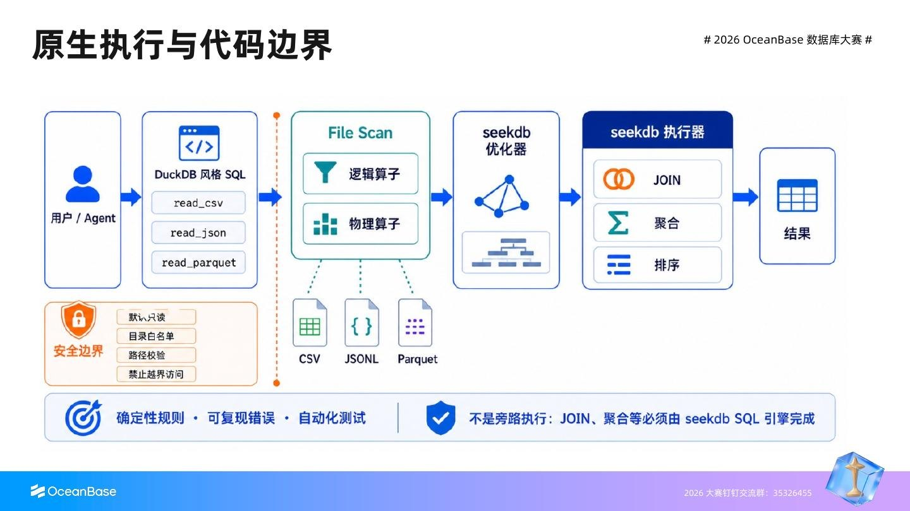

# Task05：设计记忆，连接文件数据

导出日期：2026-11-28（北京时间）

[P3 学习笔记](#p3--agent-记忆系统设计) · [I4 学习笔记](#i4--file-sql-for-ai-agent) · [参考来源](#参考来源)

## P3 · Agent 记忆系统设计

### 第一部分：为什么 AI 助手会“失忆”

学习日期：2026-11-27

**AI 没有记忆本质是数据问题**。上下文有限，模型本身有的只是训练的数据，所以要设计记忆系统，通过外部制作等方式，使其记忆能够长久化和可随不同模型版本迁移。

### 第二部分：Agent 记忆的分类框架

学习日期：2026-11-27

Agent 的记忆分为短期记忆和长期记忆，长期记忆又细分为三种类型。  
短期记忆：  
当前轮次的上下文，新开会话不会保存  
长期记忆:  
存在于会话之外，可以持久保存的信息  
**第一种：语义记忆**，理解为百科全书  
语义记忆存储的是事实和知识。关于用户的确定性信息，**记录的是什么是什么**这样确定性的可查阅的事实，不需要用户重复声明。  
**第二种：情景记忆**，可以理解为日记本  
情景记忆存储的是过去的经历和交互。不是抽象的事实，而是具体发生过的事情，**记录的是发生了什么**，包括事件的时间，地点，方法，结果。其在实践中常以 **few-shot** 示例的形式发挥作用，让 Agent 从过往成功经验中学习，用来处理当前类似的问题。  
**第三种：程序记忆**，可以理解为操作手册  
程序记忆存储的是行为规则和工作流程。**记录的是规定了遇到某种情况该怎么做**，规定的不是事实，而是行为方式。是三种长期记忆中唯一一个 Agent 可以自我修改的，可以反馈学习。其实就可以理解为 Skill。

### 第三部分：记忆的读写——什么时候记、怎么想起来

学习日期：2026-11-27

**写入**  
记忆写入主要有两种模式：

|  模式 | 描述 | 优点 | 缺点 |
| --- | --- | --- | --- |
| 实时写入（可以理解为同步吧）| 当 Agent 认为这个信息值得记录，就会直接记录进记忆 | 透明 | 占用对话推理资源 |
| 异步写入 | 对话结束后，后台任务从对话历史中提炼值得保存的信息 | 不干扰对话体验 | 写入有延迟 |

**读取**  
本质是检索问题，基于语义检索召回相关记忆，而不是按照时间线浏览历史，类似 RAG，只不过检索的是本地之前的记录。

### 第四部分：记忆系统真正的设计挑战——“忘”比“存”难

学习日期：2026-11-27

记忆系统最重要的是**记什么，忘什么**。  
全部记住，那么记忆的记录中就充斥大量无用信息，所以好的记忆需要提炼。  
全部忘记也是不可能的，而是将**不重要且过时的权重降低，新的权重提高**，而不是删除旧数据。  
因为人是不断变化的，所以好记忆系统也能是不断**变化**的。

**遗忘的处理**  
基于记忆的艾宾浩斯遗忘曲线公式

```math
\mathrm{R}(t)= e^{- \lambda t}
```

其中 $`\mathrm{R}(t)`$ 是保留率，$`t`$ 是时间，$`\lambda`$ 是遗忘速率。  
可以参考这个去做降权。而要降权可执行，就需要为每条信息算除在 0 到 1 之前的一个遗忘分数，分数越高，表明信息越新鲜可靠。而真实的记忆不止与时间相关，还取决于刚写入时多重要、放在哪一层、后来有无再被提起。故遗忘分数可以概括为：

```math
\text{遗忘分数}=\text{初始权重}\times \text{时间衰减}
```

其中时间衰减就时艾宾浩斯曲线，初始权重则是其重要性，再次访问的时间衰减会重新计算。  
当再次检索相关内容的时候，最后的结果可以概括为：

```math
\text{最终排名} \approx \text{语义相关度} \times \text{遗忘分数}
```

而记忆还是需要淘汰来节省空间的，所以要有一个**主动淘汰策略**：根据分数和访问情况决定什么时候将一条记忆从活跃的服务中移除。原则是**淘汰是分级的**，不是非删即留。

参考 PowerMem 的处置

| 处置动作 |触发条件 | 系统行为 | 用户感知 |
| --- | --- | --- | --- |
| 降权（默认）| 遗忘分数在下降，但尚未低到需要处理| 仍保留在库中，检索排名自然靠后 | 逐渐想不起来，等于软遗忘 |
| 归档 | 遗忘分数低于一定值(0.3)，或超过 30 天未被访问 | 移出日常检索，不再自动想起 | 日常对话中不再出现，但可查历史 |
| 硬淘汰 | 遗忘分数低于一定值(0.1) 且多轮机会都未被唤醒；或写入后 7 天内从未被用到 | 从存储中删除 | 彻底移除 |

总结就是**默认是降权，而归档是软淘汰。而硬淘汰则应该保守一点**。被反复使用的记忆应该升到更高级、衰减更慢。

当相关的记忆存在冲突的时候，应先识别冲突形态，判断是哪一种

| 冲突类型 | 特征 |
| --- | --- |
| 直接矛盾 | 新旧互斥，必须二选一 |
| 时间演进 | 版本更新，可合并为一条 |
| 粒度差异 | 可并存，检索时综合判断 |
| 历史与当前 | 两条都成立，适用时段不同 |

识别出形态后通常从以下策略中选择或者组合使用：

| 策略 | 做法 | 适合什么冲突 |
| --- | --- | --- |
| **时间戳优先** | 新信息覆盖旧信息 | **直接矛盾、时间演进** |
| **置信度加权** | 新旧并存，按新近度、确认次数、遗忘分数排序 | **粒度差异** |
| **人工介入** | 检测到冲突时询问用户 | **高敏感或系统不确定** |

决策顺序可以先判形态，再选策略，能自动裁决的就自动处理，不该替用户做主的再询问确认。  
冲突处理有两个时间点：

- **写入时**。新信息进来就和存量记忆比对，决定新增、更新、合并还是标记失效，适合处理明确的矛盾和时间演进，记忆库更干净。  
- **检索时**。矛盾记忆暂时都留着，被想起时再按时间和遗忘分数综合排序，适合处理可并存的粒度差异。

比较好的做法是两者进行配合：简单事实在写入阶段定下来，复杂偏好在检索阶段按分数综合。

**记忆系统还有一个关键维度是用户是否知道 AI 记住了什么，并且用户有无能力去管理这些记忆**。是一个产品信任设计。  
好的记忆系统应该让用户：

- 知道 AI 记住了什么，提供一个可查看的记忆列表  
- 能够修正错误的记忆  
- 能够删除不想被记住的内容  
- 理解记忆会如何影响 AI 的行为

多 Agent 的记忆该共享还是隔离，目前业界没有统一答案，本质是**数据主权和隐私边界的规定**。  
针对不同场景采用不同策略：

| 场景 | 建议策略 | 理由 |
| --- | --- | --- |
| 默认隔离 | 各 Agent 只访问自己的记忆 | 防止串味、保护隐私、职责清晰 |
| 按用户共享 | 同一用户跨 Agent 共享基础画像 | 减少重复自我介绍，提升一致性 |
| 按项目共享 | 同一任务/项目内的 Agent 互通 | 协作需要共同上下文 |
| 显式授权共享 | 用户确认后才跨边界流通 | 平衡体验与信任 |

实用的判断标准是如果这条记忆出现在错误的 Agent 里，用户会不会感到不适？ 会则隔离；不会可以考虑共享。

要实现隔离和共享，记忆系统在设计之初就要有一个命名空间：给每条记忆贴上标签，检索时按照标签过滤，由粗到西，标签包括：

1. 属于谁，即用户层面，同一个人在不同 Agent 里的记忆必须能区分开，这是硬边界。  
2. 属于哪个 Agent，即 Agent 层面，同一个用户名下，不同 Agent 各自维护独立的记忆空间，大家默认互不干扰。写入时自动打上 Agent 标签，读取时默认只查自己的；需要协作时，再主动跨 Agent 检索。  
3. 属于哪个任务，即任务/项目层面，同一 Agent、同一用户下，可以按项目或会话进一步分组。不是“所有记忆一股脑共享或隔离”，而是**在合适的粒度上共享**。

**可见性：在命名空间之上再加一道锁**  
命名空间解决了记忆的存储空间，但是空间内存的记忆也不一定该被所有 Agent 看到，这就需要**可见性级别**，控制谁能看。常见设计分为三档：

| 可见性 | 含义 | 适用记忆 |
| --- | --- | --- |
| 私有 | 只有写入它的 Agent 能访问 | Agent 专属的工作笔记、内部推理中间结果 |
| 组内共享 | 同一用户、同一协作组内的 Agent 可访问 | 项目组成员共用的技术栈决策、客户背景 |
| 用户级共享 | 该用户所有 Agent 均可访问 | 稳定的个人画像：角色、语言偏好、核心技能 |

当产品团队设计多 Agent 记忆时，可以按这个顺序做决策：

1. 确定用户边界，多用户场景下，用户之间必须严格隔离。  
2. 确定 Agent 边界，默认各 Agent 记忆独立，避免无意串味。  
3. 识别可共享的记忆类型，稳定的用户画像可以提升到用户级共享；项目协作用任务/项目命名空间打通。  
4. 敏感记忆默认隔离，情绪、健康、财务等话题，除非用户显式授权，不跨 Agent 流通。  
5. 提供用户可控的共享开关，让用户决定哪些记忆可以跨工具同步，而不是产品替用户做主。

需要注意的是**记忆数据的存储和管理架构，必须从设计之初就支持灵活的隔离与共享策略**

### 总结和课后行动

学习日期：2026-11-27

本次学习了 Agent 的记忆系统，类似 RAG 的存储策略，记忆的本地存储可以使得数据发挥更大作用，模型执行能力更好。同时也学到了遗忘的重要性和记忆保存的策略。

**课后行动**

1. 列出用户重复提供的信息——哪些内容用户每次都要说一遍？（角色、偏好、项目背景、技术栈……）  

   - a. 执行代码编写的时候，常常弹出 PowerShell 干扰我前台的工作，每次都要提一句。  
   - b. 我们项目面向的对象是天线优化和算法设计的研究生  
   - c. 参考之前 gui 界面的设计  
   - d. 使用透明边框的表格只是为了排版美观，不要什么情况都用

2. 按 CoALA 框架分类：  
   语义记忆：b  
   情景记忆：c  
   程序记忆：a、d

3. 思考五个设计问题：

   - 整体项目，执行规则，面向的对象应该被长期记住  
   - 旧版本的 gui 设计和交互，以及设计修改的记录应该随时间自然降权  
   - 当新旧记忆冲突时，我优先采用人工接入，因为项目不大，我一般亲自负责  
   - 这个没有考虑过，我只有让 Agent 运行时后台打印日志，写明调用的工具和执行的过程应该都是能看的差不多，但是 AI 的记忆没做过。因为都是个人使用开发。  

   如果涉及多 Agent 或者多 AI 工具，记忆其实我的思路是参考 DS 最近推出的 superAgent，由一个主 Agent 管理任务派发，workAgent 只需要执行被注入的记忆就行，最后反馈回主 Agent，具体工作记忆不共享，工作进度和流程情况与主 Agent 共享。

## I4 · File SQL for AI Agent

### 1\. Agent 为什么需要 File SQL？

学习日期：2026-11-27

AI Agent 经常面对临时文件，按照传统做法要识别文件格式，推断 Schema，创建表，然后导入数据，执行查询，最后清理临时表。但是这个步骤适合长期管理的数据，只查询一次的临时数据这些步骤太多繁琐，要多调用、检查和清理。  
File SQL 可以将文件直接解释为一张语句级临时关系。查询结束后不会再系统目录中留下持久表。

### 2\. 文件如何成为关系？

学习日期：2026-11-27

借用课程的表

| 路线 | 典型操作 | 优点 | 代价 | 适用场景 |
| --- | --- | --- | --- | --- |
| 导入为普通表 | 建表、导入、查询 | 完整事务与索引能力 | 步骤多、产生副本、需要清理 | 长期保存、反复查询 |
| 注册外表 | 创建外表后查询 | 不复制文件，可重复访问 | 仍需 DDL 与元数据治理 | 稳定数据源、共享访问 |
| 语句级文件关系 | read_csv(...) | 零建表、即时查询 | 只读、能力边界更窄 | Agent 临时分析 |

语句级文件关系**必须在 SQL 编译期间暴露列名和类型**，否则无法参与投影、过滤、链接、聚合，所以实际是把**文件扫描真正接入了数据库的关系模型和执行计划**。

### 3\. 五步最小闭环的 File SQL 体验

学习日期：2026-11-28

1. 发现文件：glob 负责在允许目录里面发现路径  
2. 理解 Schema：DESCRIBE 回答“有哪些列、各是什么类型”；EXPLAIN 则回答“数据库准备如何执行”。两者不可混用。  
3. 查询单个文件：分组聚合  
4. 连接不同格式  
5. 导出结果

### 4\. 能力边界

学习日期：2026-11-28

**边界越清楚，Agent 越能判断**何时继续、何时转换格式、何时把数据导入正式表。  
目标可行的有：

| 类别 | 能力 |
| --- | --- |
| 文件发现 | 在受控目录内使用 glob 枚举文件 |
| 文件格式 | CSV、JSONL、Parquet |
| Schema | 确定性的列名与类型推断，DESCRIBE 查看结果 |
| 单文件查询 | SELECT、表达式、WHERE、ORDER BY、LIMIT |
| 分析 | GROUP BY、HAVING、COUNT、SUM、AVG、MIN、MAX |
| 多文件关系 | 两个本地文件的 INNER JOIN、LEFT JOIN，可跨格式 |
| 结果输出 | COPY 查询结果 TO CSV |

而第一阶段的非目标：

- 不对文件关系执行 INSERT、UPDATE、DELETE 或 FOR UPDATE  
- 不原地修改输入文件，也不支持 COPY FROM  
- 不读取 XLS/XLSX、ORC、Avro、压缩包或远程对象存储  
- 不自动合并 glob 结果中的多个文件  
- 不展开嵌套 JSON 的 List、Struct 等复杂结构  
- 不提供分布式多节点文件扫描  
- 不为文件建立持久索引、统计信息或物化缓存  
- 不提供目录监听与文件变化订阅

### 5\. 三种格式的读取语义差异

学习日期：2026-11-28

| 格式 | 难点 | 要点 |
| --- | --- | --- |
| CSV | 方言和脏数据 | 处理表头、引号、转义、字段内换行、空串和 NULL。自动探测是便利功能，不是永远正确的猜测；不符业务语义就显式给参数，或按 VARCHAR 全读后再转型 |
| JSONL | 字段不齐 | 可理解为 read_json(..., format='newline_delimited')。第一阶段以扁平 JSON 对象为主，不同记录字段取并集 Schema，缺失填 NULL；嵌套不应被默默展平 |
| Parquet | 嵌套类型、高精度 Decimal 等高级类型需要与版本确认 | Schema 直接来自 Footer，不用扫文本推断；可用列裁剪 + Row Group 减少 I/O |

### 6\. 动态 Schema 如何产生？

学习日期：2026-11-28

SQL 客户端在收到第一行数据前就知道结果列，所以 Schema **必须在编译期确定**。  
其推断流程为：

1. 打开并识别文件格式  
2. 读取表头与记录  
3. 每列积累欸候选类型  
4. 合并为最终类型  
5. 构造语句级表定义  
6. 进入优化与执行

设计基线是完整扫描换确定性：编译期只保留每列的推断状态；执行期再流式扫描一次。

类型合并规则：

```
NULL + BIGINT       → BIGINT
BIGINT + DOUBLE     → DOUBLE
DATE + DATETIME     → DATETIME
数字 + 普通字符串   → VARCHAR
任意类型 + VARCHAR  → VARCHAR
```

**合并关键是可复现**

- 列名清洗：表头还要经过 BOM 清理、首尾空白处理和重名消解。  
- Schema 缓存：缓存键包含规范化路径 + device + inode + size + mtime_ns + 格式 + 推断选项 + 算法版本，只存元数据、是有界 LRU，不是内容缓存

### 7\. 执行架构

学习日期：2026-11-28

借用课程的图



Resolver 将 read_csv(...) 解析成带动态列定义的临时关系；优化器生成文件扫描算子；执行器再以批次方式把数据交给普通关系算子。  
判断实现边界时，应关注两点：

- EXPLAIN 中应看到文件扫描叶子以及原生 JOIN、AGG、SORT 等节点  
- 不应把完整 SQL 旁路交给 DuckDB、SQLite、Polars 等外部查询引擎执行

**Reader 与 SQL 引擎的分工表**

| File Reader 负责 | SQL 引擎负责 |
| --- | --- |
| 文件 I/O	 | 表达式求值 |
| CSV、JSONL、Parquet 解析 | WHERE 过滤 |
| 字段到 SQL 类型的转换 | JOIN |
| 安全的列裁剪 | GROUP BY 与聚合 |
| 产出类型化数据批次 | ORDER BY、LIMIT |

Reader 不应理解业务 SQL，更不能自己再实现一套 JOIN。执行内存应与批次大小、投影列宽和算子状态相关，而不是随文件大小线性增长，先化为内存表的话，“流式”就形同虚设。

### 8\. 一致性：文件没有 MVCC 怎么办

学习日期：2026-11-28

数据库表有事务快照，本地文件没有。查询中途别人覆盖/追加文件，结果可能混了两个版本。  
通过文件指纹：

```
device + inode + size + mtime_ns
```

编译期记一次，打开时核一次，扫描结束时再核一次,任何关键字段变化都应触发 FILE_CHANGED 类错误，并让整条 SQL 失败。即使客户端已收到部分流式结果，也应把本次结果视为无效。

**TOCTOU**(Time-of-Check to Time-of-Use )：先 open，再对 fd 做 fstat，后续一直读同一个 fd，避免路径检查完成后目标被替换。这部分和我目前在学的 Linux 的文件管理相关了。  
文件指纹只能提供变化检测，不等于数据库快照。它只能检测变化并让查询失败，不能提供旧版本可重复读。要强快照就老老实实导入正式表。

### 9\. 安全

学习日期：2026-11-28

让 SQL 读取服务器文件会扩大攻击面。File SQL **必须默认关闭**，并要求管理员配置唯一受控根目录。  
这表明**只读也是有风险的**，路径安全的检查如下：

1. 功能是否启用  
2. ecure_file_priv 是否配置  
3. 路径规范化与 realpath  
4. 是否位于允许根目录  
5. 是否为普通文件  
6. 以只读、安全标志打开  
7. 对文件描述符再次校验

必须拒绝：

- 使用 .. 逃逸根目录  
- 利用相同字符串前缀绕过目录边界  
- 通过符号链接跳到白名单外  
- 读取目录、FIFO、Socket、块设备或字符设备  
- 从数据库服务器读取客户端电脑上的同名路径

SQL 里的路径属于数据库服务器进程，不是发起查询的客户端。 所以单机 seekdb 是更清晰的部署边界；分布式环境下“本地路径在哪个节点”根本没稳定语义。  
还要限制单文件大小、列数、字段长度、行长、JSON key 数量；日志和 EXPLAIN 可以显示白名单内相对路径，但**不该记录文件正文**。

**COPY TO 如何安全导出**  
COPY TO 写查询结果，但不改变输入文件关系。  
六条安全要求：输出也在白名单内、默认不覆盖、先写同目录临时文件再原子发布、失败/取消要清理、格式可复现、禁止输出指向输入文件本身。  
Agent 在导出后还应验证目标文件存在、行数或摘要符合预期，再把路径交给用户。

### 10\. 面向 Agent 的工具协议

学习日期：2026-11-28

Agent 不应获得一个无限制的 run_sql 工具后自由试错。更稳妥的做法是列表分别注册其可用的有限制的工具。  
**Agent 的操作准则**

- 先发现再读取，不猜测路径  
- 先 DESCRIBE 再写 SQL，不猜测列名与类型  
- 先小样本再全量，预览必须 LIMIT  
- 明确选择列，避免不必要的 SELECT *  
- 全量聚合前估算文件大小和资源预算  
- 文件变化、格式或权限错误时立即停止，不自动放宽配置  
- 导出使用新文件名，并在返回前验证结果  
- 将 SQL、输入指纹、Schema 和输出路径写入审计记录

**错误分类与可观测性**

| 错误 | Agent 应对 |
| --- | --- |
| FILE_SQL_DISABLED | 停下，让管理员配 |
| ACCESS_DENIED |别换路径绕过 |
| FORMAT_NOT_SUPPORTED | 转格式或导入表 |
| SCHEMA_INFERENCE_FAILED | 查方言、表头、参数 |
| INVALID_RECORD | 定位行号修源文件 |
| UNSUPPORTED_NESTED_VALUE | 预处理 JSON |
| FILE_CHANGED | 丢结果，等文件稳定重试 |

诊断信息可含相对路径、行号、列名、预期/实际类型摘要，但**不能泄露白名单外绝对路径或完整敏感记录**。

### 11\. 如何测试 File SQL？

学习日期：2026-11-28

**正确性测试**

- 用内容等价的 CSV、JSONL、Parquet 验证查询结果  
- 覆盖投影、过滤、排序、聚合、HAVING 与 LIMIT  
- 覆盖同格式和跨格式 INNER / LEFT JOIN  
- 验证 NULL、空字符串、日期、布尔和数值边界  
- 验证 DESCRIBE 与实际返回列一致  
- COPY TO 后重新读取并比对原查询

**鲁棒性与安全测试**

- CSV 引号、转义、字段内换行和不完整记录  
- JSONL 缺失字段、非法 JSON 与嵌套对象  
- Parquet 不支持类型和损坏 Footer  
- ..、符号链接、前缀碰撞和特殊文件  
- 编译后、执行前及执行中修改文件  
- COPY 目标已存在、磁盘写满、查询失败和取消  
- 超大字段、超多列、长行与大量 JSON Key

**架构边界测试**  
EXPLAIN 应证明 File Scan 是叶子算子，JOIN、AGG、SORT 由原生执行器承担。内存测试应证明扫描占用与批次和投影宽度相关，而不是随文件总大小线性增长。

### 常见误区及解答

学习日期：2026-11-28

**File SQL 是“即时关系化”的工具，而不是持久数据库、数据湖连接器和通用文件系统 API 的替代品。**

文件关系是语句级对象，不创建持久表，也不产生可长期复用的数据副本。  
公开接口可以采用相似风格，但 Reader 只产出数据批次，关系运算由本地 SQL 引擎执行。  
邮编、证件号和带前导零的编码可能被误判为数字。业务语义不明确时应显式读取为 VARCHAR。  
路径属于数据库服务器进程。客户端路径即使同名，也不代表服务器上存在同一文件。  
指纹只能检测变化并让查询失败，不能提供文件旧版本的可重复读。  
任意文件读取足以泄露密钥、配置和系统信息。白名单、realpath、文件类型检查与资源限制缺一不可。

### 总结和思考

学习日期：2026-11-28

File SQL 把文件解释为临时性的语义关系，不会在查询结束后留下持久表，所以适合一次性分析  
动态 Schema 在执行前探查元数据；类型判断的真实矛盾是确定性和精确性；文件指纹既是性能机制决定缓存命中也是正确性机制用于核对。  
Reader 与引擎的边界的判断就是看这件事需不需要知道业务语义。  
文件只读也同样有风险，需要设计安全措施。  
**思考题**

1. 为什么 read_csv(...) 的 Schema 必须在 SQL 执行前确定？
   SQL 客户端在接收第一行数据前就需要知道结果列。因此，文件关系的 Schema 必须在编译阶段确定。

2. 如果只抽样前 1000 行推断类型，可能出现哪些不稳定结果？
   虽然块，但是第 1001 行可能就有出错的情况，同一文件两次查询可能出不同结果，不能稳定复现问题

3. 文件在查询过程中变化时，为什么“继续返回尽可能多的结果”不适合 Agent？
   由于是混合查询，前后结果可能冲突，但是 Agent 不一定能判别

4. Reader 内部执行 JOIN 会破坏哪些架构边界？
   那么会让其相当于复制 SQL 的功能，负责 SQL 的职责，同时也有泄密的风险

5. 如何设计一个既方便 Agent 使用、又不能越过 secure_file_priv 的文件发现工具？
   目前想到的就是类似于只给相对路径，或者只读工作区经过审核放入的

## 参考来源

| 章节 | 来源 |
| --- | --- |
| P3 | [Datawhale · Agent 记忆系统设计](https://datawhalechina.github.io/easy-data-x-ai/pm/P3%20%E8%AF%BE%E7%A8%8B%E7%A8%BF%EF%BC%9AAgent%20%E8%AE%B0%E5%BF%86%E7%B3%BB%E7%BB%9F%E8%AE%BE%E8%AE%A1.html) |
| I4 | [Datawhale · File SQL for AI Agent](https://datawhalechina.github.io/easy-data-x-ai/industry/I4%20%E8%AF%BE%E7%A8%8B%E7%A8%BF%EF%BC%9AFile%20SQL%20for%20AI%20Agent.html) |
